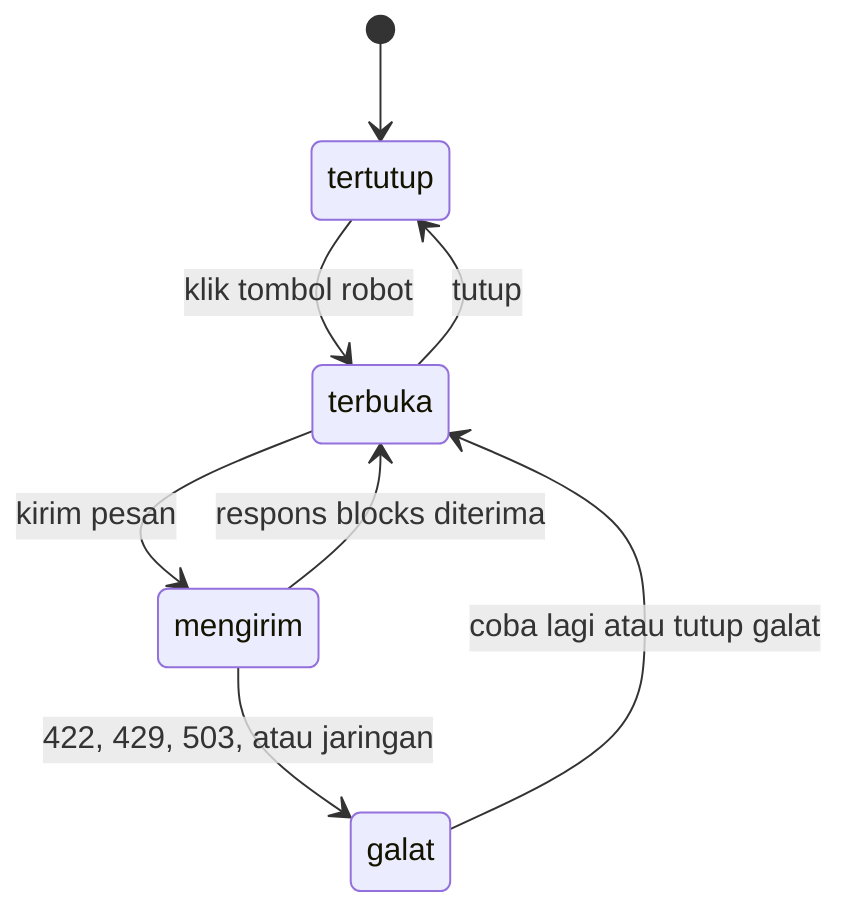

# Software Design Document (SDD)
## Website Empirise Jalan-Jalan

| | |
|---|---|
| **Versi** | 1.0 (Draft) |
| **Tanggal** | 6 November 2026 |
| **Stack** | Laravel 13 (PHP 8.3 sampai 8.5), MySQL 8 / MariaDB 10.6+, Blade + Alpine.js + Tailwind, Laravel AI SDK |
| **Dokumen terkait** | `PRD_Empirise_Jalan-Jalan.md`, `SRS_Empirise_Jalan-Jalan.md`, `SYSTEM_ARCHITECTURE.md`, `analsis_pweb_empiris.docx` |

---

## 1. Pendahuluan

### 1.1 Tujuan

SDD ini menjabarkan rancangan terperinci yang langsung dapat diimplementasikan: skema basis data, model, rute, kontrak API, kelas Service dan Agent, algoritma, template email, aturan validasi, dan rancangan antarmuka. Arsitektur tingkat tinggi ada di `SYSTEM_ARCHITECTURE.md`, kebutuhan di SRS.

### 1.2 Catatan Penting Pemakaian

1. **Tabel dasar.** Nama dan kolom final 20 tabel dasar mengikuti analisis Bagian 9. Bagian 3 memuat kolom minimum yang dibutuhkan fitur di SRS. Jika analisis memakai nama lain, ikuti analisis dan petakan.
2. **Kode contoh** bersifat ilustratif untuk menunjukkan rancangan. Sesuaikan dengan dokumentasi resmi versi Laravel dan Laravel AI SDK yang terpasang. Versi `laravel/ai` dikunci di `composer.json`.
3. **Parameter bisnis** (batas, ambang, hari pengingat) dipusatkan di `config/empirise.php` (Bagian 14), bukan ditulis langsung di kode.

### 1.3 Konvensi

- Uang: bilangan bulat Rupiah (`BIGINT UNSIGNED`), tanpa desimal.
- Waktu: `Asia/Jakarta`, disimpan sebagai `TIMESTAMP`/`DATETIME` sesuai zona aplikasi.
- Penamaan tabel dan kolom: Indonesia, `snake_case`. Primary key `id_<entitas>`.
- Status: string dengan nilai terbatas (enum PHP backed enum di `app/Enums`).

---

## 2. Keputusan Desain Utama

| Kode | Keputusan | Alasan |
|---|---|---|
| D-01 | Backed enum PHP untuk semua status | Nilai valid terpusat, aman terhadap salah ketik |
| D-02 | Uang `BIGINT` Rupiah | Hindari kesalahan pembulatan |
| D-03 | Peringkat destinasi: TF-IDF tersimpan, skor = cosine | Cepat, dapat dijelaskan, sesuai analisis |
| D-04 | Agent hanya menghasilkan teks atau objek terstruktur. Penulisan data selalu oleh Service lewat endpoint | AI tidak bisa mengubah data tanpa klik klien |
| D-05 | Draf chat disimpan di tabel `draf_chat` | Klien dapat meninjau, mengubah, mengirim, atau membatalkan |
| D-06 | Kalender dibaca dari `proyek` (status bukan batal) | Satu sumber kebenaran. Gunakan tabel agenda bila analisis memilikinya |
| D-07 | Email diantrekan setelah commit (`afterCommit`), dengan kunci idempotensi | Tidak ada email ganda atau email untuk transaksi yang batal |
| D-08 | Satu endpoint chat per mode. Mode ditentukan server dari status login | Pengguna tidak dapat memilih mode akun |
| D-09 | Parameter bisnis di `config/empirise.php` | Dapat diatur tanpa mengubah kode |
| D-10 | Respons chat berupa daftar blok (`blocks`) bertipe | Antarmuka merender kartu secara seragam |

---

## 3. Desain Basis Data

### 3.1 Tabel (kolom minimum)

Semua tabel InnoDB, `utf8mb4`, memiliki `created_at` dan `updated_at` kecuali dinyatakan lain.

**`users`**

| Kolom | Tipe | Catatan |
|---|---|---|
| `id` | BIGINT UNSIGNED PK | |
| `nama` | VARCHAR(120) | |
| `email` | VARCHAR(190) UNIQUE | |
| `telepon` | VARCHAR(20) NULL | Format 08xx atau +62 |
| `password` | VARCHAR(255) | bcrypt |
| `role` | ENUM('klien','admin') | Bawaan `klien` |
| `email_verified_at` | TIMESTAMP NULL | |

**`destinasi`**

| Kolom | Tipe | Catatan |
|---|---|---|
| `id_destinasi` | BIGINT UNSIGNED PK | |
| `nama`, `slug` | VARCHAR | `slug` UNIQUE |
| `id_wilayah`, `id_kategori` | FK | Mengacu tabel master analisis |
| `deskripsi` | TEXT | |
| `tag` | JSON | Contoh: `["pantai","sunset","keluarga"]` |
| `foto_path` | VARCHAR(255) NULL | |
| `aktif` | BOOLEAN | Bawaan 1 |
| `vektor_tfidf` | JSON NULL | Peta `term` ke bobot (sudah ternormalisasi L2) |
| `vektor_diperbarui_at` | TIMESTAMP NULL | |

**`konsultasi`**

| Kolom | Tipe | Catatan |
|---|---|---|
| `id_konsultasi` | BIGINT UNSIGNED PK | |
| `nomor` | VARCHAR(20) UNIQUE | Format `KNS-2026-0001` |
| `id_klien` | FK users NULL | Null untuk tamu sebelum tertaut |
| `nama_kontak`, `email_kontak`, `telepon_kontak` | VARCHAR | Diisi untuk tamu |
| `id_layanan` | FK NULL | |
| `tujuan` | VARCHAR(255) NULL | |
| `jumlah_peserta`, `durasi_hari` | SMALLINT UNSIGNED NULL | |
| `tgl_rencana` | DATE NULL | |
| `jenis_kendaraan` | VARCHAR(30) NULL | Preferensi `Mobil`, `Minibus`, `Bus`, atau `Belum menentukan`; khusus rental |
| `lokasi_jemput` | VARCHAR(255) NULL | Wajib untuk permintaan rental |
| `jam_jemput` | TIME NULL | Perkiraan waktu lokal |
| `tanggal_kembali` | DATE NULL | Tidak lebih awal dari `tgl_rencana` bila keduanya diisi |
| `minat` | JSON NULL | |
| `kebutuhan` | TEXT | Cerita klien |
| `preferensi_json` | JSON NULL | Hasil ekstraksi |
| `id_itinerary` | FK NULL | `itinerary_draft` |
| `status` | VARCHAR(20) | `baru`, `dibalas`, `penawaran`, `deal`, `batal` |
| `aktivitas_klien_at` | TIMESTAMP NULL | Untuk pengingat 2 hari |

Indeks: `(id_klien, status)`, `(status, updated_at)`, `(email_kontak)`.

**`balasan_konsultasi`**: `id_balasan`, `id_konsultasi` FK (cascade), `pengirim` ENUM('klien','admin'), `id_pengirim` FK NULL, `isi` TEXT, `terkirim_email` BOOLEAN.

**`itinerary_draft`**

| Kolom | Tipe | Catatan |
|---|---|---|
| `id_itinerary` | BIGINT UNSIGNED PK | |
| `sesi_id` | VARCHAR(64) | Indeks. Penghubung sebelum login |
| `id_klien`, `id_konsultasi` | FK NULL | Terisi setelah penautan |
| `sumber` | ENUM('publik','akun') | |
| `ringkasan_cerita` | TEXT NULL | Ringkasan tanpa PII |
| `preferensi_json`, `itinerary_json` | JSON | |
| `status` | ENUM('draft','dikirim','dipakai') | |
| `model` | VARCHAR(60) | Model yang dipakai |
| `versi` | SMALLINT UNSIGNED | Bawaan 1 |

**`penawaran`**

| Kolom | Tipe | Catatan |
|---|---|---|
| `id_penawaran` | BIGINT UNSIGNED PK | |
| `id_konsultasi` | FK | |
| `versi` | SMALLINT UNSIGNED | UNIQUE bersama `id_konsultasi` |
| `status` | VARCHAR(20) | `draft`, `dikirim`, `disetujui`, `revisi`, `ditolak` |
| `judul` | VARCHAR(190) | |
| `catatan_admin`, `catatan_klien` | TEXT NULL | `catatan_klien` wajib saat revisi |
| `total` | BIGINT UNSIGNED | Dihitung dari detail |
| `dikirim_at`, `ditanggapi_at`, `disetujui_at` | TIMESTAMP NULL | |

**`detail_penawaran`**: `id_detail`, `id_penawaran` FK (cascade), `urutan`, `nama_item`, `deskripsi` NULL, `jumlah` DECIMAL(10,2), `satuan` VARCHAR(30), `harga_satuan` BIGINT UNSIGNED NULL (null = belum diisi), `asal` ENUM('manual','itinerary').

**`proyek`**: `id_proyek`, `id_penawaran` **UNIQUE** FK, `id_konsultasi` FK, `id_klien` FK, `nama`, `tgl_mulai`, `tgl_selesai`, `status` (`terjadwal`, `berjalan`, `selesai`, `batal`), `total_nilai` BIGINT, `catatan` NULL. Indeks `(tgl_mulai)`, `(status)`.

**`termin_pembayaran`**: `id_termin`, `id_proyek` FK, `nama` (DP, Pelunasan), `nominal` BIGINT, `jatuh_tempo` DATE, `status` (`belum`, `sebagian`, `lunas`; dihitung dari pembayaran).

**`pembayaran`**: `id_pembayaran`, `id_termin` FK, `nominal` BIGINT, `tgl_bayar` DATE, `bukti_path` NULL, `dicatat_oleh` FK users, `catatan` NULL.

**`testimoni`**: `id_testimoni`, `id_proyek` **UNIQUE** FK, `id_klien` FK, `rating` TINYINT (1 sampai 5), `komentar` TEXT, `status` (`menunggu`, `tampil`, `disembunyikan`).

**`draf_chat`** (tabel tambahan dari SDD ini)

| Kolom | Tipe | Catatan |
|---|---|---|
| `id_draf` | BIGINT UNSIGNED PK | |
| `id_klien` | FK users | Pemilik |
| `jenis` | ENUM('revisi','pesan') | |
| `id_konsultasi` | FK | |
| `id_penawaran` | FK NULL | Untuk jenis `revisi` |
| `isi` | TEXT | Dapat diubah klien |
| `status` | ENUM('draft','dikirim','dibatalkan') | |
| `kedaluwarsa_at` | TIMESTAMP | Hapus draf lama tak terkirim |

**`chatbot_log`**: `id_log`, `mode` ENUM('publik','akun'), `id_klien` NULL, `sesi_id`, `ringkasan_pertanyaan` VARCHAR(255), `terjawab` BOOLEAN, `status` (`ok`, `gagal`, `dibatasi`), `latensi_ms`, `konteks_json` NULL, `created_at`. Tidak menyimpan cerita mentah.

**`rekomendasi_log`**: `id_log`, `sesi_id`, `preferensi_json`, `hasil_json` (id dan skor), `latensi_ms`, `created_at`.

**`faq_chatbot`**: `id_faq`, `kata_kunci` JSON, `pertanyaan`, `jawaban`, `aktif`.

**`email_template`**: `id`, `jenis` UNIQUE, `subjek`, `isi` TEXT, `aktif` BOOLEAN, `diubah_oleh` FK NULL.

**`email_log`**

| Kolom | Tipe | Catatan |
|---|---|---|
| `id_email` | BIGINT UNSIGNED PK | |
| `id_konsultasi` | FK NULL | |
| `jenis` | VARCHAR(40) | Kunci template |
| `referensi` | VARCHAR(60) | Id penawaran, termin, tanggal, atau urutan pengingat |
| `ke_email` | VARCHAR(190) | |
| `subjek` | VARCHAR(255) | |
| `status` | ENUM('terjadwal','terkirim','gagal') | |
| `percobaan` | TINYINT | |
| `jadwal_kirim`, `terkirim_at` | TIMESTAMP NULL | |
| `error` | TEXT NULL | |

Kunci idempotensi: **UNIQUE** `(id_konsultasi, jenis, referensi, ke_email)`. Indeks `(status, jadwal_kirim)`.

### 3.2 Aturan Integritas

| Aturan | Mekanisme |
|---|---|
| Satu penawaran disetujui menghasilkan satu proyek | UNIQUE `proyek.id_penawaran` |
| Satu testimoni per proyek | UNIQUE `testimoni.id_proyek` |
| Versi penawaran unik per konsultasi | UNIQUE `(id_konsultasi, versi)` |
| Penawaran terkirim tidak boleh memiliki harga kosong | Validasi di `PenawaranService::kirim()` |
| Hapus konsultasi menghapus balasan dan detail | `ON DELETE CASCADE` pada anak langsung |
| Data keuangan tidak dihapus keras | Tanpa cascade ke `pembayaran`, gunakan soft delete atau larangan hapus |

### 3.3 Urutan Migration

1. `users` (tambah `role`, `telepon`), tabel master (wilayah, kategori, layanan)
2. `destinasi`, `portofolio`, `klien_logo`, `testimoni` (tanpa FK proyek dahulu), `faq`, `faq_chatbot`
3. `itinerary_draft`
4. `konsultasi`, `balasan_konsultasi`
5. `penawaran`, `detail_penawaran`
6. `proyek`, `termin_pembayaran`, `pembayaran`, lalu FK `testimoni.id_proyek`
7. `draf_chat`, `chatbot_log`, `rekomendasi_log`
8. `email_template`, `email_log`
9. FK `konsultasi.id_itinerary`
10. Seeder: layanan (5), wilayah, kategori, destinasi contoh, `faq_chatbot`, `email_template` (11 jenis), akun admin awal

---

## 4. Desain Model Eloquent

| Model | Relasi | Cast / Scope penting |
|---|---|---|
| `User` | `hasMany(Konsultasi, id_klien)`, `hasMany(Proyek)` | `role` sebagai `Role` enum. `isAdmin()` |
| `Konsultasi` | `belongsTo(User)`, `hasMany(BalasanKonsultasi)`, `hasMany(Penawaran)`, `belongsTo(ItineraryDraft)` | `status` enum, `minat` dan `preferensi_json` sebagai array. Scope `milikKlien($user)`, `aktif()` |
| `Penawaran` | `belongsTo(Konsultasi)`, `hasMany(DetailPenawaran)`, `hasOne(Proyek)` | `status` enum. Scope `terbaru()`. Metode `hitungTotal()`, `adaHargaKosong()` |
| `DetailPenawaran` | `belongsTo(Penawaran)` | `subtotal` accessor `jumlah * harga_satuan` |
| `Proyek` | `belongsTo(Penawaran)`, `hasMany(TerminPembayaran)`, `hasOne(Testimoni)` | Scope `untukKalender()` (status bukan batal) |
| `TerminPembayaran` | `belongsTo(Proyek)`, `hasMany(Pembayaran)` | Accessor `terbayar`, `sisa`. Metode `perbaruiStatus()` |
| `ItineraryDraft` | `belongsTo(Konsultasi)`, `belongsTo(User)` | `preferensi_json`, `itinerary_json` sebagai array |
| `Destinasi` | `belongsTo(Wilayah)`, `belongsTo(Kategori)` | `tag` array, `vektor_tfidf` array. Scope `aktif()` |
| `DrafChat` | `belongsTo(User)`, `belongsTo(Konsultasi)` | Scope `milikKlien()`, `masihBerlaku()` |
| `EmailLog`, `EmailTemplate` | `EmailLog belongsTo(Konsultasi)` | Scope `terjadwal()`, `gagal()` |

Pemetaan nama tabel dan primary key (Laravel 13, atribut):

```php
#[Table('konsultasi', key: 'id_konsultasi')]
class Konsultasi extends Model { /* ... */ }
```

Alternatif (semua versi): `protected $table = 'konsultasi'; protected $primaryKey = 'id_konsultasi';`.

Enum status di `app/Enums`: `KonsultasiStatus`, `PenawaranStatus`, `ProyekStatus`, `TerminStatus`, `Role`, `ChatMode`.

---

## 5. Desain Rute dan Controller

### 5.1 Web (publik dan akun)

| Rute | Nama | Controller@aksi | Middleware |
|---|---|---|---|
| `GET /` | `beranda` | `Publik\BerandaController@index` | |
| `GET /tentang`, `/layanan`, `/destinasi`, `/destinasi/{slug}`, `/portofolio`, `/portofolio/{slug}`, `/kalender`, `/faq-kontak` | `tentang`, `layanan`, ... | `Publik\*Controller@index/show` | |
| `GET /rekomendasi`, `POST /rekomendasi` | `rekomendasi.*` | `Publik\RekomendasiController` | throttle |
| `GET /rencana` | `rencana` | `Publik\RencanaController@index` | |
| `GET /konsultasi/baru`, `POST /konsultasi` | `konsultasi.*` | `Publik\KonsultasiController@create/store` | throttle |
| `/masuk`, `/daftar`, `/lupa-password`, `/reset-password` | | Breeze | `guest` |
| `GET /akun` | `akun.beranda` | `Akun\BerandaController` | `auth` |
| `GET /akun/konsultasi`, `/akun/konsultasi/{konsultasi}` | `akun.konsultasi.*` | `Akun\KonsultasiController` | `auth`, `can:view,konsultasi` |
| `POST /akun/konsultasi/{konsultasi}/balasan` | | `Akun\BalasanController@store` | `auth`, `can:view,konsultasi` |
| `POST /akun/konsultasi/{konsultasi}/batal` | | `Akun\KonsultasiController@batal` | `auth`, `can:batal,konsultasi` |
| `GET /akun/penawaran/{penawaran}` | `akun.penawaran.show` | `Akun\PenawaranController@show` | `auth`, `can:view,penawaran` |
| `GET /akun/proyek`, `/akun/proyek/{proyek}` | | `Akun\ProyekController` | `auth`, `can:view,proyek` |
| `GET/POST /akun/proyek/{proyek}/testimoni` | | `Akun\TestimoniController` | `auth`, `can:beriTestimoni,proyek` |
| `GET/PATCH /akun/profil` | | `Akun\ProfilController` | `auth` |

Kunci pengikatan rute (`{konsultasi}`) memakai primary key. Akses data milik klien lain mengembalikan **404** (tidak membocorkan keberadaan data), bukan 403: Policy dipakai lewat `Route::scopeBindings` dan `Konsultasi::milikKlien()` pada resolusi.

### 5.2 API (JSON, sesi dan CSRF)

| Rute | Controller@aksi | Middleware |
|---|---|---|
| `POST /api/chat/publik` | `Api\ChatPublikController@kirim` | `throttle:chat-publik` |
| `POST /api/chat/akun` | `Api\ChatAkunController@kirim` | `auth`, `throttle:chat-akun` |
| `GET /api/chat/akun/riwayat` | `Api\ChatAkunController@riwayat` | `auth` |
| `POST /api/chat/akun/draf/{draf}/kirim` | `Api\DrafChatController@kirim` | `auth`, `can:kelola,draf` |
| `PATCH /api/chat/akun/draf/{draf}` | `Api\DrafChatController@ubah` | `auth`, `can:kelola,draf` |
| `DELETE /api/chat/akun/draf/{draf}` | `Api\DrafChatController@batal` | `auth`, `can:kelola,draf` |
| `POST /api/ai/preferensi` | `Api\PreferensiController@store` | `throttle:ai-preferensi` |
| `POST /api/ai/itinerary` | `Api\ItineraryController@store` | `throttle:ai-itinerary` |
| `GET /api/itinerary/{id}` | `Api\ItineraryController@show` | pemilik sesi atau klien |
| `POST /api/itinerary/{id}/kirim` | `Api\ItineraryController@kirim` | `throttle:konsultasi` |
| `POST /api/penawaran/{penawaran}/respons` | `Api\PenawaranResponsController@store` | `auth`, `can:tanggapi,penawaran` |

### 5.3 Rate Limiter (didaftarkan di `AppServiceProvider`)

| Nama | Batas | Kunci |
|---|---|---|
| `chat-publik` | 30 pesan per sesi (jendela sesi), cadangan 60 per jam per IP | `sesi_id` dan IP |
| `chat-akun` | 60 per jam | id pengguna |
| `ai-itinerary` | 5 per jam | IP |
| `ai-preferensi` | 20 per jam | IP |
| `konsultasi` | 5 per jam | IP |
| `login` | 5 per menit | email dan IP (bawaan Breeze) |

Respons 429 membawa header `Retry-After`.

### 5.4 Admin

Panel admin menggunakan Blade, Alpine.js, dan Tailwind pada `/admin`, dilindungi middleware `auth` dan `role:admin`. Rute dan halaman:

| Menu | Rute | Controller |
|---|---|---|
| Dashboard | `GET /admin` | `Admin\DashboardController` |
| Konsultasi | `GET /admin/konsultasi`, detail, dan balasan | `Admin\ConsultationController` |
| Proyek dan pembayaran | `GET/POST /admin/proyek`, status, pembayaran termin | `Admin\ProjectController` |
| Kalender | `GET/POST /admin/kalender` | `Admin\CalendarController` |
| Konten web | `GET/POST/PATCH/DELETE /admin/konten` | `Admin\ContentController` |
| Laporan | `GET /admin/laporan` dan ekspor CSV/XLSX | `Admin\ReportController` |
| Pengguna | `GET/POST/PATCH /admin/pengguna` | `Admin\UserController` |
| Chatbot AI | `GET/POST/PATCH/DELETE /admin/chatbot` | `Admin\ChatbotController` |

Audit untuk perubahan penting disimpan pada `audit_log` dalam transaksi yang sama dengan perubahan bisnis. Data konten yang aktif dan berstatus `tampil` dipakai untuk mengganti bagian terkait pada situs publik; metadata kategori disimpan sebagai objek JSON. `WebsiteContentSeeder` mengimpor konten awal yang sebelumnya ditulis di beranda, halaman layanan, portofolio, klien, FAQ, dan tim ke `konten_admin` secara idempoten tanpa menimpa perubahan admin. Data awal bertanda `CONTOH` sampai diverifikasi biro. Setelah data awal tersedia, CMS menjadi sumber untuk bagian-bagian tersebut, termasuk slider dan katalog destinasi. Pratinjau konten tersedia dalam dialog sebelum simpan atau pembaruan dan memakai struktur serta kelas visual kartu publik untuk kategori terkait; perubahan pada input, metadata, ikon, dan gambar langsung tercermin tanpa mengirim perubahan ke server.

Fondasi panel mencakup model penawaran, draf dan pengiriman penawaran, tanggapan klien, serta persetujuan deal atomik. Versi lama tetap tersimpan dan revisi membuat versi baru. Moderasi testimoni serta konfigurasi template email tetap mengikuti tahapan implementasi berikutnya.

---

## 6. Desain Kontrak API

Semua respons JSON. Kesalahan memakai bentuk seragam:

```json
{ "kode": "VALIDASI_GAGAL", "pesan": "Cerita maksimal 1500 karakter.", "kesalahan": { "cerita": ["..."] }, "aksi_cadangan": null }
```

| HTTP | `kode` | Keterangan |
|---|---|---|
| 401 | `BELUM_LOGIN` | Perlu login |
| 403 | `DILARANG` | Peran tidak sesuai |
| 404 | `TIDAK_DITEMUKAN` | Termasuk data milik klien lain |
| 409 | `STATUS_TIDAK_VALID` | Misalnya penawaran sudah ditanggapi |
| 422 | `VALIDASI_GAGAL` | Aturan Form Request |
| 429 | `TERLALU_BANYAK` | Throttle |
| 503 | `AI_TIDAK_TERSEDIA` | Gagal atau timeout. Berisi `aksi_cadangan` |

### 6.1 `POST /api/chat/publik` dan `/api/chat/akun`

Permintaan:

```json
{ "pesan": "Kantor kami mau gathering 40 orang di Jogja...", "mode_cerita": true, "konteks": { "id_konsultasi": 12 } }
```

`konteks` hanya untuk mode akun dan diverifikasi kepemilikannya di server. `mode_cerita` menaikkan batas dari 500 ke 1500 karakter.

Respons 200:

```json
{
  "sesi_id": "b2f1...",
  "blocks": [
    { "type": "text", "text": "Saya menangkap: gathering akhir tahun untuk sekitar 40 karyawan..." },
    { "type": "quick_replies", "items": ["2 hari 1 malam", "Sekitar Jogja"] },
    { "type": "destinasi_cards", "items": [{ "id_destinasi": 3, "nama": "Kaliurang", "wilayah": "DIY", "foto": "/storage/...", "skor": 0.62 }] },
    { "type": "itinerary_card", "id_itinerary": 41, "judul": "Gathering 2 Hari di Yogyakarta", "ringkasan": "...", "jumlah_hari": 2 },
    { "type": "draf", "id_draf": 7, "jenis": "revisi", "isi": "Mohon ...", "aksi": ["kirim", "ubah", "batal"] },
    { "type": "error", "kode": "AI_TIDAK_TERSEDIA", "pesan": "...", "aksi_cadangan": "/konsultasi/baru" }
  ]
}
```

Blok `draf` hanya muncul pada mode akun.

### 6.2 `POST /api/ai/preferensi`

Permintaan `{ "cerita": "...", "jawaban_lanjutan": { "durasi_hari": 2 } }`. Respons 200: `{ "preferensi": { ...skema 8.1 SRS... }, "pertanyaan": ["Berapa hari kegiatannya?"], "lengkap": false }`.

### 6.3 `POST /api/ai/itinerary`

Permintaan `{ "preferensi": { ... } }`. Respons 200: `{ "id_itinerary": 41, "itinerary": { ...skema 8.2 SRS... }, "label": "Gambaran awal" }`. Respons 503 membawa `aksi_cadangan: "/konsultasi/baru"`.

### 6.4 `POST /api/itinerary/{id}/kirim`

Permintaan (tamu): `{ "nama": "...", "email": "...", "telepon": "..." }`. Klien login tidak perlu mengirim identitas. Respons 201: `{ "id_konsultasi": 15, "nomor": "KNS-2026-0015", "url": "/akun/konsultasi/15" }`. Pengiriman kedua untuk itinerary yang sama mengembalikan konsultasi yang sama (idempoten).

### 6.5 `POST /api/penawaran/{id}/respons`

Permintaan `{ "aksi": "setuju" | "revisi" | "tolak", "catatan": "..." }`. `catatan` wajib untuk `revisi`. Respons 200: `{ "status": "disetujui", "id_proyek": 9, "url": "/akun/proyek/9" }`. Respons 409 bila status bukan `dikirim`.

### 6.6 Draf Chat

`POST /api/chat/akun/draf/{id}/kirim` menjalankan aksi nyata sesuai `jenis`:

| Jenis | Aksi |
|---|---|
| `revisi` | `PenawaranService::mintaRevisi($penawaran, $klien, $isi)` |
| `pesan` | Membuat `balasan_konsultasi` dari klien dan memicu notifikasi ke admin |

Draf berstatus `dikirim` tidak dapat dikirim ulang (409).

---

## 7. Desain Service

### 7.1 `PiiMasker`

Tujuan: mengurangi kemungkinan PII keluar ke penyedia AI.

| Jenis | Pola | Pengganti |
|---|---|---|
| Email | Regex email umum | `[EMAIL]` |
| Telepon Indonesia | `(?:\+62|62|0)8[1-9][0-9]{6,11}` (spasi dan tanda hubung dinormalkan dahulu) | `[TELEPON]` |
| Nomor identitas | 16 digit berurutan | `[ID]` |
| Nama dikenal | Nama dari sesi, form, atau akun (kata utuh, tidak peka huruf besar) | `[NAMA]` |
| Pola perkenalan | `nama saya X`, `saya X dari ...` (heuristik terbatas) | `[NAMA]` |

```php
final class PiiMasker {
    public function samarkan(string $teks, array $namaDikenal = []): string { /* urutan: email, telepon, id, nama */ }
}
```

Batasan yang diakui: nama yang tidak dikenal dan tidak berpola dapat lolos. Mitigasi: catatan privasi di UI, instruksi agar AI tidak meminta PII, dan tidak menyimpan cerita mentah di log.

### 7.2 `RecommendationService`

**Dokumen destinasi.** Teks tiap destinasi dibentuk dari field berbobot (boost dapat diubah di `config/empirise.php`):

| Field | Pengulangan (boost) |
|---|---|
| `tag` | 3 |
| `kategori` | 2 |
| `wilayah` | 2 |
| `nama` | 1 |
| `deskripsi` | 1 |

**Pra-pemrosesan.** Huruf kecil, hapus tanda baca, tokenisasi per kata, buang stopword bahasa Indonesia, stemming ringan (misalnya `sastrawi/sastrawi`). Opsional bigram untuk frasa seperti `team building`.

**Pembobotan.**

- `tf(t,d) = 1 + ln(f(t,d))` (sublinear)
- `idf(t) = ln((N + 1) / (df(t) + 1)) + 1`, dengan N jumlah destinasi aktif
- `w(t,d) = tf * idf`, lalu normalisasi L2 sehingga `cosine = dot product`

**Penyimpanan.** Vektor sparse `{term: bobot}` di `destinasi.vektor_tfidf`. Karena IDF global, setiap perubahan destinasi (tambah, ubah, aktif, hapus) memicu `HitungUlangVektorJob` untuk semua destinasi (aman untuk ratusan destinasi). IDF juga di-cache (`tfidf:idf`).

**Kueri.** Dari `Preferensi` dibentuk teks kueri: `minat`, `kata_kunci`, `wilayah`, `tujuan_kegiatan`, `layanan`, dan `kebutuhan_khusus` (diproses seperti dokumen). Vektor kueri memakai IDF tersimpan, dinormalkan L2.

```
skor(d) = cosine(q, vektor(d)) + bonus_wilayah(d)
bonus_wilayah = 0.15 bila wilayah destinasi ada di preferensi.wilayah, selain itu 0
```

Hasil: destinasi aktif dengan `skor >= ambang_skor` (bawaan 0,05), diurutkan menurun, diambil `top_n` (bawaan 5). Jika tak ada yang lolos ambang, kembalikan daftar kosong dan alur beralih ke pesan bahwa kebutuhan perlu dikonsultasikan. Setiap panggilan dicatat di `rekomendasi_log`.

Antarmuka:

```php
final class RecommendationService {
    /** @return Collection<int, array{destinasi: Destinasi, skor: float}> */
    public function rekomendasikan(array $preferensi, int $topN = null): Collection {}
    public function hitungUlangSemua(): void {}
}
```

### 7.3 `PenawaranService`

| Metode | Perilaku |
|---|---|
| `buatDariItinerary(Konsultasi $k, ItineraryDraft $i): Penawaran` | Membuat penawaran `draft` versi berikutnya. Baris detail dari `kebutuhan_pendukung` dan `layanan_pendukung` setiap kegiatan, dedup berdasarkan nama ternormalisasi, `jumlah` = `jumlah_peserta` atau 1, `harga_satuan = null`, `asal = itinerary` |
| `kirim(Penawaran $p): void` | Menolak bila `adaHargaKosong()`. Hitung total, status `dikirim`, status konsultasi `penawaran`, antrekan email |
| `setujui(Penawaran $p, User $klien): Proyek` | Transaksi dengan kunci baris (di bawah) |
| `mintaRevisi(Penawaran $p, User $klien, string $catatan): void` | Status `revisi`, simpan `catatan_klien`, status konsultasi `dibalas`, notifikasi admin |
| `tolak(Penawaran $p, User $klien, ?string $catatan): void` | Status `ditolak` |
| `buatVersiBaru(Penawaran $lama): Penawaran` | Salin detail ke versi baru `draft`. Versi lama tidak diubah |

```php
public function setujui(Penawaran $p, User $klien): Proyek
{
    return DB::transaction(function () use ($p, $klien) {
        $p = Penawaran::whereKey($p->getKey())->lockForUpdate()->firstOrFail();

        abort_unless(
            $p->status === PenawaranStatus::Dikirim && $p->konsultasi->id_klien === $klien->getKey(),
            409
        );

        $p->update(['status' => PenawaranStatus::Disetujui, 'disetujui_at' => now(), 'ditanggapi_at' => now()]);
        $p->konsultasi->update(['status' => KonsultasiStatus::Deal]);

        $proyek = Proyek::create([
            'id_penawaran' => $p->getKey(),
            'id_konsultasi' => $p->id_konsultasi,
            'id_klien' => $klien->getKey(),
            'nama' => $p->judul,
            'tgl_mulai' => $p->konsultasi->tgl_rencana,
            'status' => ProyekStatus::Terjadwal,
            'total_nilai' => $p->total,
        ]);

        DB::afterCommit(fn () => app(NotifikasiService::class)->deal($proyek));

        return $proyek;
    });
}
```

`lockForUpdate` mencegah dua klik bersamaan menghasilkan dua proyek. Batas UNIQUE `proyek.id_penawaran` menjadi lapis pengaman kedua.

### 7.4 `NotifikasiService`

Satu metode per jenis email (`konsultasiDiterima`, `itineraryDikirim`, `balasanAdmin`, `penawaranDikirim`, `deal`, `infoPembayaran`, ...). Semua memanggil `kirim(jenis, referensi, penerima, data)` yang:

1. Memeriksa `email_template.aktif`.
2. Menyisipkan baris `email_log` `terjadwal` (gagal diam-diam bila kunci UNIQUE sudah ada, artinya sudah pernah diantrekan).
3. Mengantrekan `KirimEmailJob` setelah commit.

### 7.5 `KonsultasiService`

| Metode | Perilaku |
|---|---|
| `buat(array $data, ?User $klien): Konsultasi` | Membuat nomor, simpan, set `aktivitas_klien_at`, antrekan email |
| `buatDariItinerary(ItineraryDraft $i, array $kontak, ?User $klien)` | Idempoten: jika `itinerary.id_konsultasi` sudah ada, kembalikan yang ada |
| `tautkanKeAkun(User $user)` | Menautkan konsultasi dan itinerary dengan `email_kontak` sama, atau `sesi_id` sesi saat ini |

---

## 8. Desain AI

### 8.1 Daftar Agent

| Agent | Skema keluaran | Tool | Batas waktu |
|---|---|---|---|
| `PreferensiAgent` | Preferensi (structured) | Tidak ada | 10 detik |
| `ItineraryAgent` | Itinerary (structured) | Tidak ada | 30 detik |
| `ChatPublikAgent` | Teks | `CariFaq`, `RekomendasiDestinasi`, `BuatItinerary`, `CekStatusTanggal` | 10 detik |
| `AsistenAkunAgent` | Teks | Tool publik + `AmbilKonsultasiSaya`, `AmbilPenawaran`, `AmbilProyekDanTagihan`, `SusunDrafRevisi`, `SusunDrafPesan`, `SimpanItinerary` | 10 detik |

Kerangka Agent (ilustratif, sesuaikan dengan dokumentasi SDK yang terpasang):

```php
namespace App\Ai\Agents;

use Illuminate\Contracts\JsonSchema\JsonSchema;
use Laravel\Ai\Contracts\Agent;
use Laravel\Ai\Contracts\HasStructuredOutput;

class ItineraryAgent implements Agent, HasStructuredOutput
{
    public function __construct(private array $preferensi, private array $kandidat) {}

    public function instructions(): string
    {
        // prompt sistem Bagian 15.5 Panduan, ditambah daftar kandidat sebagai konteks
    }

    public function schema(JsonSchema $schema): array
    {
        // judul, ringkasan, pemahaman_kebutuhan, hari[], kebutuhan_pendukung, pertanyaan_lanjutan, disclaimer
    }
}
```

Pemanggilan dibungkus `Services/Ai/ItineraryGenerator` agar controller tidak bergantung pada API SDK.

### 8.2 Kontrak Tool

| Tool | Masukan dari model | Akses data | Keluaran | Menulis? |
|---|---|---|---|---|
| `CariFaq` | `kata_kunci` | `faq_chatbot` aktif | Daftar tanya-jawab | Tidak |
| `RekomendasiDestinasi` | `preferensi` | `RecommendationService` | Maks 5 destinasi dengan skor | Tidak |
| `BuatItinerary` | `preferensi` | `ItineraryGenerator` | `id_itinerary` dan ringkasan | Menyimpan `itinerary_draft` (bukan data bisnis) |
| `CekStatusTanggal` | `tanggal` | Agregat dari `proyek` | `tersedia`, `terbatas`, `penuh` tanpa nama klien | Tidak |
| `AmbilKonsultasiSaya` | tidak ada | `Konsultasi::milikKlien(Auth::user())` | Status dan balasan terakhir | Tidak |
| `AmbilPenawaran` | `id_penawaran` | Penawaran milik klien, status bukan `draft` | Komponen, total, versi | Tidak |
| `AmbilProyekDanTagihan` | tidak ada | Proyek dan termin milik klien | Jadwal, termin, sisa | Tidak |
| `SusunDrafRevisi` | `id_penawaran`, `cerita` | Penawaran milik klien | Membuat `draf_chat` (jenis revisi) | Hanya draf |
| `SusunDrafPesan` | `id_konsultasi`, `cerita` | Konsultasi milik klien | Membuat `draf_chat` (jenis pesan) | Hanya draf |
| `SimpanItinerary` | `id_konsultasi`, `id_itinerary` | Keduanya milik klien | Itinerary tertaut sebagai versi baru | Hanya setelah konfirmasi |

Aturan semua Tool akun: identitas klien **tidak pernah** menjadi parameter. Tool mengambilnya dari `Auth::user()` pada saat dijalankan. Jika data bukan milik klien, Tool mengembalikan `tidak ditemukan`.

### 8.3 Orkestrasi `ItineraryGenerator`

```
generate(preferensi):
  kandidat = RecommendationService.rekomendasikan(preferensi, 5)
  jika kandidat kosong: lempar TidakAdaKandidat
  coba hingga 2 kali:
     hasil = ItineraryAgent(preferensi, kandidat).prompt()   // timeout 30 detik
     jika valid(hasil, kandidat): kembalikan hasil
  lempar ItineraryTidakValid
valid(hasil, kandidat):
  skema lengkap, jumlah hari >= 1, setiap id_destinasi null atau termasuk kandidat,
  tidak ada pola harga (Rp, ribu, juta, diskon) pada teks, disclaimer tetap hadir
```

Pemeriksaan pola harga adalah jaring pengaman tambahan atas aturan BR-01. Jika `ItineraryTidakValid` atau timeout: controller membalas 503 dengan `aksi_cadangan`.

### 8.4 Pencatatan

| Log | Isi |
|---|---|
| `chatbot_log` | mode, id klien, sesi, ringkasan pertanyaan, terjawab, status, latensi |
| `rekomendasi_log` | preferensi, id dan skor hasil, latensi |
| Laravel log | Kegagalan AI (jenis, latensi, jumlah retry) tanpa isi pesan |

### 8.5 Pengujian AI

Seluruh uji memakai fake bawaan SDK, tanpa memanggil API sungguhan. Skenario: keluaran valid, `id_destinasi` di luar kandidat (harus ditolak dan diulang), teks memuat harga (harus ditolak), timeout (harus 503), draf tidak terkirim tanpa panggilan endpoint kirim.

---

## 9. Desain Email

### 9.1 Kelas

| Mailable | Jenis (`email_template.jenis`) | Referensi idempotensi | Data |
|---|---|---|---|
| `KonsultasiDiterimaMail` | `konsultasi_diterima` | `-` | nomor, ringkasan, `{link_konsultasi}` |
| `KonsultasiBaruAdminMail` | `konsultasi_baru_admin` | `-` | nama, ringkasan |
| `ItineraryDikirimMail` | `itinerary_dikirim` | id itinerary | itinerary, `{link_itinerary}` |
| `BalasanAdminMail` | `balasan_admin` | id balasan | `{cuplikan_balasan}` |
| `PengingatKonsultasiMail` | `pengingat_konsultasi` | urutan (1 atau 2) | ringkasan |
| `PenawaranDikirimMail` | `penawaran_dikirim` | id penawaran | versi, `{total}`, `{link_penawaran}` |
| `PengingatPenawaranMail` | `pengingat_penawaran` | id penawaran dan urutan | `{link_penawaran}` |
| `DealMail` | `deal` | id proyek | tanggal, langkah berikutnya |
| `InfoPembayaranMail` | `info_pembayaran` | id termin dan status | `{termin}`, `{nominal}` |
| `PengingatKegiatanMail` | `pengingat_kegiatan` | id proyek dan `h7` atau `h1` | `{tgl_mulai}` |
| `MintaTestimoniMail` | `minta_testimoni` | id proyek | `{link_testimoni}` |

Pengirim `Admin Empirise <admin@empirise.id>` dari `MAIL_FROM_*`, `Reply-To` ke email admin. Isi dirender dari `email_template` (subjek dan isi dengan variabel). Variabel yang tidak dikenal dibiarkan kosong, bukan mengganggu pengiriman. Tampilan dasar memakai satu layout Markdown mail bertema merah `#D32F2F` dengan tombol ke tautan terkait dan tanda tangan biro.

### 9.2 `KirimEmailJob`

```
KirimEmailJob(id_email):
  tries = 3, backoff = [60, 300, 900]
  handle: muat email_log; jika status terkirim, selesai
          render template; Mail::to(...)->send(...)
          status = terkirim, terkirim_at = sekarang
  failed: status = gagal, simpan error, percobaan++
```

### 9.3 Pengingat Terjadwal

Didaftarkan di `routes/console.php`:

```php
Schedule::command('empirise:pengingat')->everyFifteenMinutes()->withoutOverlapping();
Schedule::command('empirise:bersihkan')->dailyAt('02:00');
```

`empirise:pengingat` menjalankan tiga kueri:

| Pengingat | Kondisi pencarian |
|---|---|
| Konsultasi | `status IN (baru, dibalas)`, `aktivitas_klien_at <= now - 2 hari`, pengingat terkirim < 2 |
| Penawaran | `status = dikirim`, `dikirim_at <= now - 3 hari`, pengingat terkirim < 2 |
| Kegiatan | `proyek.status = terjadwal`, `tgl_mulai` tepat H-7 atau H-1 |

Tiap kandidat lewat `NotifikasiService::kirim()` sehingga kunci UNIQUE mencegah ganda. `empirise:bersihkan` menghapus atau menganonimkan `chatbot_log` akun dan riwayat chat lebih dari 90 hari, `itinerary_draft` tanpa konsultasi lebih dari 30 hari, dan `draf_chat` kedaluwarsa.

---

## 10. Desain Otorisasi

### 10.1 Policy

| Policy | Metode | Aturan |
|---|---|---|
| `KonsultasiPolicy` | `view`, `balas` | Admin, atau `konsultasi.id_klien == user.id` |
| | `batal` | Pemilik, dan status bukan `deal` atau `batal` |
| `PenawaranPolicy` | `view` | Admin, atau pemilik konsultasi dan status bukan `draft` |
| | `tanggapi` | Pemilik, status `dikirim` |
| `ProyekPolicy` | `view` | Admin atau pemilik |
| | `beriTestimoni` | Pemilik, status `selesai`, belum ada testimoni |
| `DrafChatPolicy` | `kelola` | `draf.id_klien == user.id`, status `draft`, belum kedaluwarsa |
| `ItineraryDraftPolicy` | `view` | Admin, klien pemilik, atau `sesi_id` sama dengan sesi saat ini |

```php
public function view(User $user, Konsultasi $k): bool
{
    return $user->isAdmin() || $k->id_klien === $user->getKey();
}
```

### 10.2 Middleware

`EnsureRole:admin` untuk `/admin`. Selain itu `auth`, `verified` (opsional bila verifikasi email diaktifkan), dan throttle sesuai Bagian 5.3.

---

## 11. Desain Validasi (Form Request)

| Request | Aturan inti |
|---|---|
| `RegistrasiRequest` | `nama` wajib maks 120; `email` wajib, email, unik; `telepon` wajib, pola `^(\+62|62|0)8[1-9][0-9]{6,11}$`; `password` wajib, minimal 8, konfirmasi |
| `KonsultasiRequest` | `id_layanan` nullable exists; `tujuan` nullable maks 255; `jumlah_peserta` nullable integer 1 sampai 5000; `durasi_hari` nullable integer 1 sampai 30; `tgl_rencana` nullable date setelah hari ini; `minat` nullable array; `kebutuhan` wajib maks 3000; khusus rental: jenis kendaraan dan lokasi jemput wajib, jam jemput dan tanggal kembali opsional; tanggal kembali tidak mendahului tanggal rencana; untuk tamu: `nama_kontak`, `email_kontak`, `telepon_kontak` wajib |
| `CeritaRequest` | `cerita` wajib string, 10 sampai 1500 karakter |
| `PesanChatRequest` | `pesan` wajib maks 500 (atau 1500 jika `mode_cerita`); `konteks.id_konsultasi` nullable, dicek kepemilikan |
| `ResponsPenawaranRequest` | `aksi` in `setuju,revisi,tolak`; `catatan` wajib jika `revisi`, maks 2000 |
| `PenawaranRequest` (admin) | `judul` wajib; `detail` array minimal 1; tiap `nama_item` wajib; `jumlah` > 0; `harga_satuan` integer >= 0, wajib saat kirim |
| `TerminRequest` | `nama` wajib; `nominal` integer > 0; `jatuh_tempo` date; jumlah termin tidak melebihi total proyek |
| `PembayaranRequest` | `id_termin` exists; `nominal` integer > 0 dan tidak melebihi sisa; `tgl_bayar` date; `bukti` nullable file mimes `jpg,jpeg,png,pdf` maks 2048 KB |
| `TestimoniRequest` | `rating` integer 1 sampai 5; `komentar` wajib maks 1000 |

Pesan kesalahan dalam bahasa Indonesia (`lang/id/validation.php`). Nama berkas unggahan dibuat acak lewat penyimpanan Laravel (`hashName`).

---

## 12. Desain Antarmuka

### 12.1 Komponen Blade

| Komponen | Properti | Catatan |
|---|---|---|
| `x-button` | `variant` (`primary`, `glass`, `outline`, `soft`), `href`, `icon` | Pill, tinggi 40 px |
| `x-section-heading` | `eyebrow`, `title`, `subtitle` | Eyebrow merah kapital, judul 32 px |
| `x-card` | `padding` | Radius 16 px, bayangan lembut |
| `x-chat-widget` | `mode` (`publik` atau `akun`, dari server), `endpoint` | Lihat 12.2 |
| `x-itinerary-timeline` | `itinerary` | Timeline per hari |
| `x-destinasi-card` | `destinasi`, `skor?` | |
| `x-status-badge` | `status` | Warna per status |
| `x-navbar`, `x-footer` | | Sesuai Figma |

### 12.2 Widget Chat

Mode ditentukan saat render Blade: `@auth` memberi `mode="akun"` dan endpoint `/api/chat/akun`, `@guest` memberi `mode="publik"`. Klien tidak dapat mengubahnya dari browser karena server menolak mode yang tidak cocok dengan sesi.



| Blok | Render |
|---|---|
| `text` | Gelembung teks (teks biasa, bukan HTML) |
| `quick_replies` | Tombol pilihan cepat |
| `destinasi_cards` | Deret kartu destinasi |
| `itinerary_card` | Kartu ringkas dengan tombol Lihat Itinerary Lengkap dan Kirim ke Empirise |
| `draf` | Kartu dengan isi dapat diedit dan tombol Kirim, Ubah, Batal |
| `error` | Pesan ramah dengan tautan `aksi_cadangan` |

Perilaku: indikator mengetik saat `mengirim`, penghitung karakter (500 atau 1500), catatan privasi di bawah kolom, `aria-live="polite"` pada daftar pesan, fokus kembali ke kolom input setelah respons, dukungan `prefers-reduced-motion`. Saat login atau logout, halaman dimuat ulang sehingga mode berganti.

### 12.3 Slider Hero

Data: `Destinasi::aktif()->urut()->take(12)`. State Alpine: `indeksAktif`. Perubahan indeks memperbarui latar (cross-fade 400 ms), judul, wilayah, dan deskripsi. Autoplay 6 detik, berhenti saat hover atau fokus dan saat `prefers-reduced-motion`. Penghitung `02 / 12` dan garis progres merah. Kartu samping dari Swiper dengan `slidesPerView: 'auto'`.

### 12.4 Carousel Portofolio

Swiper dengan efek coverflow: `centeredSlides: true`, `slidesPerView: 'auto'`, `loop: true`. Kartu tengah: skala 1, bayangan merah, tombol **Lihat dokumentasi**. Kartu samping: skala 0,9, overlay abu-abu gelap, tanpa tombol. Pagination titik (aktif berupa pill merah) dan dua panah bulat putih.

### 12.5 Halaman `/rencana`

Dua kolom (desktop): kiri kolom cerita besar dan pertanyaan lanjutan, kanan hasil (kartu destinasi dan timeline itinerary). Di ponsel, hasil di bawah. Bagian atas hasil memuat label **Gambaran awal** dan disclaimer tetap. Tombol: **Kirim ke Empirise**, **Ubah Rencana**, dan (opsional) **Unduh PDF**.

### 12.6 Halaman Penawaran Klien

Ringkasan, tabel komponen (item, jumlah, satuan, harga, subtotal), total, riwayat versi. Tiga tombol: **Setuju dan Lanjutkan** (merah), **Minta Revisi** (outline, membuka kolom catatan wajib), **Tolak**. **Setuju** membuka dialog konfirmasi berisi ringkasan total dan tanggal. Setelah berhasil, halaman sukses dengan ringkasan dan langkah berikutnya. Status bukan `dikirim` menampilkan mode baca saja.

### 12.7 Admin

Detail konsultasi memuat: tab Percakapan, panel **Pemahaman Kebutuhan** (ringkasan dan `Preferensi` dalam bentuk daftar), panel **Itinerary AI** (timeline), dan aksi **Buat Penawaran dari Itinerary**.

---

## 13. Penanganan Kesalahan

| Sumber | Penanganan | Hasil ke pengguna |
|---|---|---|
| Validasi | `ValidationException` | 422 atau kembali ke form dengan pesan per kolom |
| Data tidak ada atau bukan milik | `ModelNotFoundException` dan Policy ke 404 | Halaman 404 |
| Status tidak valid | `abort(409)` | Pesan: tindakan sudah diproses |
| Throttle | 429 | Pesan dan waktu tunggu |
| AI gagal atau timeout | `AiTidakTersedia`, retry sekali | 503 dengan `aksi_cadangan` |
| AI keluaran tidak valid | `ItineraryTidakValid`, retry sekali | Sama seperti di atas |
| SMTP gagal | Job retry 3 kali, `email_log.status = gagal` | Tidak terlihat oleh klien. Admin melihat di log email |
| Kesalahan tak terduga | Handler global, laporan ke pelacak kesalahan | Halaman 500 ramah |

Prinsip: kegagalan AI atau email tidak pernah menggagalkan transaksi bisnis.

---

## 14. Konfigurasi `config/empirise.php`

```php
return [
    'ai' => [
        'timeout_chat'        => 10,
        'timeout_itinerary'   => 30,
        'retry_tidak_valid'   => 1,
        'maks_pesan'          => 500,
        'maks_cerita'         => 1500,
        'top_n'               => 5,
        'itinerary_per_jam_ip'=> 5,
        'pesan_per_sesi_publik'=> 30,
        'pesan_per_jam_akun'  => 60,
    ],
    'rekomendasi' => [
        'ambang_skor'   => 0.05,
        'bonus_wilayah' => 0.15,
        'boost'         => ['tag' => 3, 'kategori' => 2, 'wilayah' => 2, 'nama' => 1, 'deskripsi' => 1],
    ],
    'email' => [
        'pengingat_konsultasi_hari' => 2,
        'pengingat_penawaran_hari'  => 3,
        'maks_pengingat'            => 2,
        'h_minus_kegiatan'          => [7, 1],
        'percobaan'                 => 3,
    ],
    'retensi' => [
        'chat_akun_hari'                 => 90,
        'itinerary_tanpa_konsultasi_hari'=> 30,
        'email_log_hari'                 => 365,
    ],
    'upload' => ['maks_kb' => 2048, 'mimes' => ['jpg', 'jpeg', 'png', 'pdf']],
];
```

Kunci penyedia AI dan model berada di `config/ai.php` dan `.env`, bukan di berkas ini.

---

## 15. Desain Pengujian

| Berkas uji | Cakupan | SRS |
|---|---|---|
| `Unit/PiiMaskerTest` | Email, telepon, ID, nama dikenal, pola perkenalan | REQ-ITN-02, NFR-S07 |
| `Unit/TfIdfTest` | Tokenisasi, bobot, normalisasi, cosine, ambang, bonus wilayah | REQ-REK-02 sampai 04 |
| `Unit/PenawaranTotalTest` | Total, harga kosong, versi baru | REQ-PNW-01 sampai 03 |
| `Feature/Ai/PreferensiAgentTest` | Ekstraksi dengan fake, `info_kurang` maks 3 | REQ-ITN-03, 04 |
| `Feature/Ai/ItineraryGeneratorTest` | Id di luar kandidat ditolak, harga ditolak, timeout menjadi 503 | REQ-ITN-06 sampai 09 |
| `Feature/Ai/ChatPublikTest` | Tanpa harga, tanpa akses data klien | REQ-CBP-04, 05 |
| `Feature/Isolasi/ChatAkunIsolasiTest` | Klien A tidak dapat membaca data klien B lewat Tool dan API | REQ-CBA-02, 03, NFR-S05 |
| `Feature/Chat/DrafChatTest` | Draf tidak terkirim tanpa endpoint, tidak bisa kirim ulang | REQ-CBA-08 sampai 10 |
| `Feature/Penawaran/SetujuiPenawaranTest` | Transaksi atomik, satu proyek, klik ganda, status tidak valid | REQ-PNW-05 sampai 10 |
| `Feature/Konsultasi/KonsultasiFlowTest` | Tamu dan klien, penautan akun, itinerary idempoten | REQ-KON, REQ-AKN-06 |
| `Feature/Email/NotifikasiTest` | Antrean, kunci idempotensi, retry, template nonaktif | REQ-EML-12, 14 |
| `Feature/Email/PengingatTest` | Batas 2 pengingat, berhenti saat klien merespons | REQ-EML-05, 07, 10, 13 |
| `Feature/Pembayaran/PembayaranTest` | Sisa tagihan, status termin, unggah bukti | REQ-PRY |
| `Feature/Akses/PolicyTest` | Peran dan kepemilikan | REQ-AKN-05 |
| `Feature/Throttle/RateLimitTest` | Login, itinerary, chat | NFR-S08, REQ-ITN-13 |

Alat: Pest 4, `Mail::fake`, `Queue::fake`, fake AI SDK, factory untuk semua model. Lighthouse dan uji beban dijalankan terpisah dari suite ini.

---

## 16. Urutan Implementasi

| Tahap | Isi | Hasil yang dapat didemonstrasikan |
|---|---|---|
| 1 | Setup proyek, Breeze, Tailwind, font, token, komponen dasar, migration dan seeder | Kerangka siap |
| 2 | Beranda dan halaman publik sesuai Figma | Landing page jadi |
| 3 | Registrasi, login, konsultasi (tamu dan klien), balasan, email dasar | Konsultasi end-to-end |
| 4 | Panel admin Blade: konsultasi, proyek, termin, pembayaran, kalender, konten, laporan, pengguna, chatbot | Admin mengelola operasi yang sudah tersedia |
| 5 | `PenawaranService`, tanggapan klien, deal atomik, proyek, testimoni | Deal lewat website |
| 6 | `RecommendationService` dan halaman `/rekomendasi` | Rekomendasi tanpa AI |
| 7 | `PiiMasker`, `PreferensiAgent`, `ItineraryAgent`, `/rencana`, penautan ke konsultasi dan penawaran | Itinerary AI |
| 8 | Chatbot Publik | Chat pengunjung |
| 9 | Asisten Akun, Tool, draf chat, isolasi data | Asisten klien |
| 10 | Email penuh: 11 jenis, template admin, scheduler pengingat, pembersihan retensi | Otomasi |
| 11 | Responsif, aksesibilitas, kinerja, keamanan, UAT | Rilis |

Tahap 6 sebelum 7 disengaja: mesin rekomendasi harus stabil sebelum ditambah AI.

---

## 17. Keterlacakan Desain terhadap SRS

| Area SRS | Bagian SDD |
|---|---|
| REQ-PUB | 5.1, 12.1, 12.3, 12.4 |
| REQ-AKN | 3.1 (`users`), 5.1, 10, 11 |
| REQ-KON | 3.1, 5, 7.5, 11 |
| REQ-REK | 7.2, 3.1 (`destinasi`, `rekomendasi_log`) |
| REQ-ITN | 6.2 sampai 6.4, 7.1, 8.1, 8.3, 12.5 |
| REQ-CBP | 5.2, 6.1, 8.1, 8.2, 12.2 |
| REQ-CBA | 5.2, 6.1, 6.6, 8.1, 8.2, 10, 12.2 |
| REQ-PNW | 3.1, 6.5, 7.3, 12.6 |
| REQ-PRY | 3.1, 5.4, 11 |
| REQ-EML | 7.4, 9 |
| REQ-ADM | 5.4, 12.7 |
| NFR | 5.3, 8.2, 9, 10, 13, 15 |

---

## 18. Hal Terbuka

| Kode | Hal | Dampak desain |
|---|---|---|
| DQ-01 | Kolom final 20 tabel dasar di analisis Bagian 9 | Petakan Bagian 3 ke nama dan kolom analisis, termasuk apakah `termin_pembayaran` dan tabel agenda sudah ada |
| DQ-02 | Tabel `draf_chat` belum ada di SRS | Tambahan SDD. Konfirmasi, lalu perbarui SRS dan analisis |
| DQ-03 | Stemmer bahasa Indonesia (`sastrawi/sastrawi`) dan daftar stopword | Pilih paket dan uji kualitas dengan data destinasi nyata |
| DQ-04 | Verifikasi email (`verified`) wajib atau tidak | Menentukan middleware `verified` di rute akun |
| DQ-05 | Detail API `laravel/ai` pada versi yang dipakai (nama kelas, metode, konfigurasi, fake) | Sesuaikan Bagian 8 saat implementasi |
| DQ-06 | Nilai ambang skor dan bonus wilayah | Tentukan lewat uji dengan data nyata dan responden |
| DQ-07 | Format nomor konsultasi dan penomoran bila ada banyak proses bersamaan | Gunakan urutan atomik per tahun |
| DQ-08 | Apakah kalender memakai tabel agenda terpisah | Bergantung analisis (D-06) |
