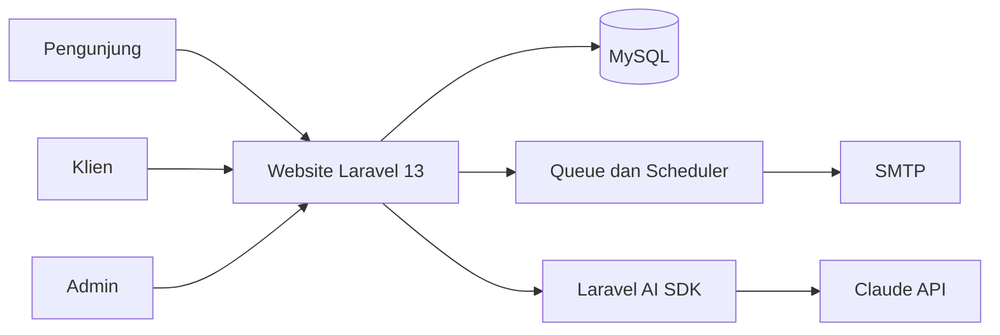
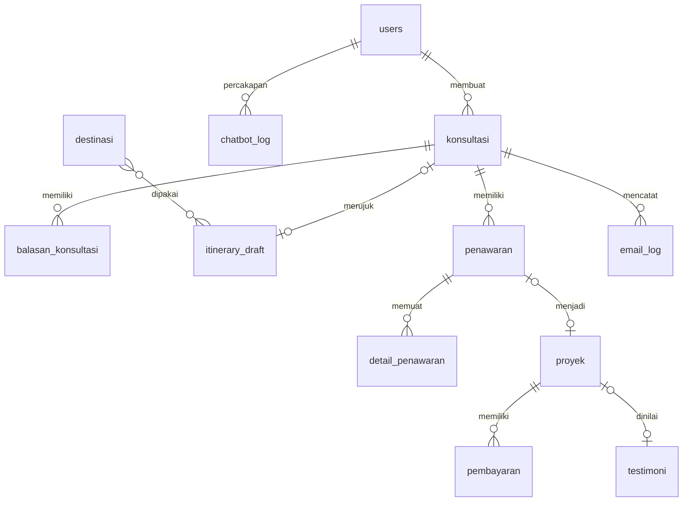
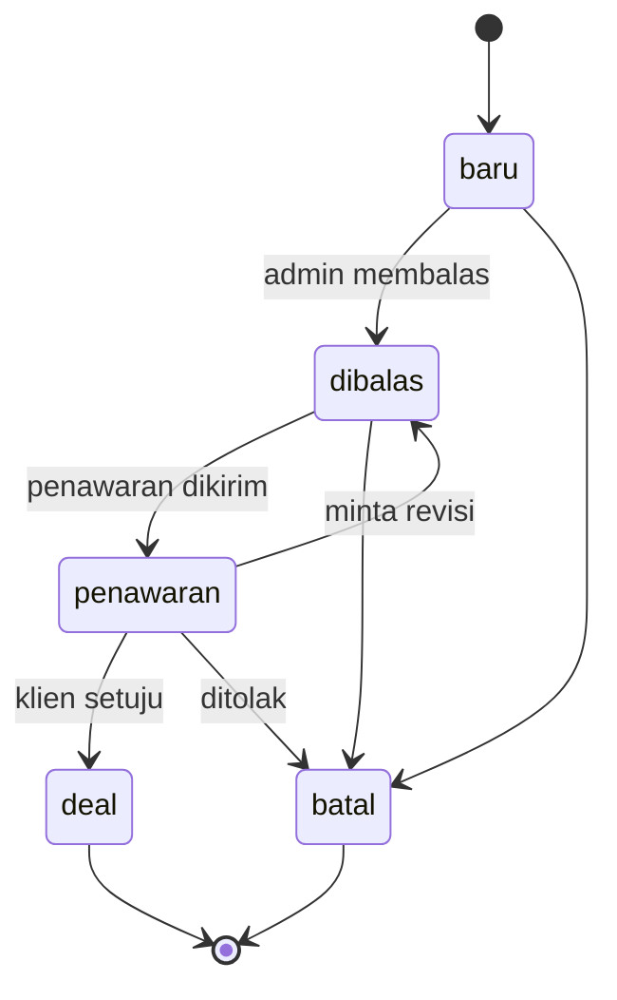
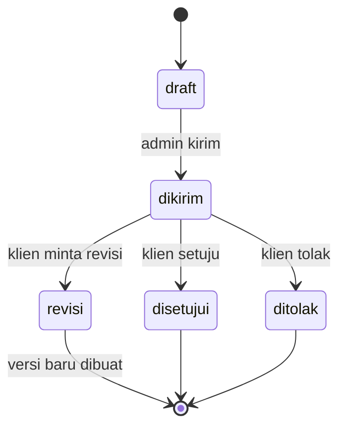

# Spesifikasi Kebutuhan Perangkat Lunak (SRS)
## Website Empirise Jalan-Jalan

| | |
|---|---|
| **Dokumen** | Software Requirements Specification (mengacu pada struktur ISO/IEC/IEEE 29148) |
| **Versi** | 1.0 (Draft) |
| **Tanggal** | 6 November 2026 |
| **Produk** | Website pemesanan kegiatan kustom Empirise Jalan-Jalan |
| **Platform** | Laravel 13 (PHP 8.3 sampai 8.5), MySQL 8 / MariaDB 10.6+ |
| **Dokumen terkait** | PRD Empirise Jalan-Jalan, `analsis_pweb_empiris.docx`, Panduan Membangun Website Empirise (desain ke kode), Figma UI-UX-EMPIRISE |

---

## 1. Pendahuluan

### 1.1 Tujuan

Dokumen ini menetapkan kebutuhan fungsional dan non-fungsional website Empirise Jalan-Jalan secara terukur dan dapat diuji. Pembaca utama: pengembang (termasuk AI agent coding), penguji, dan perwakilan biro yang menyetujui lingkup.

### 1.2 Lingkup Produk

Sistem adalah aplikasi web yang memungkinkan:

1. Calon klien mengenal layanan, menceritakan kebutuhan, menerima rekomendasi dan itinerary gambaran kasar dari AI, lalu berkonsultasi.
2. Klien menerima penawaran, menanggapinya (deal), serta memantau proyek dan pembayaran.
3. Admin mengelola konsultasi, penawaran, proyek, pembayaran, dan konten.
4. Sistem mengirim email otomatis atas nama admin pada setiap tahap.
5. Dua chatbot AI: Chatbot Publik untuk pengunjung dan Asisten Akun untuk klien yang login.

**Di luar lingkup:** payment gateway, harga otomatis atau estimasi harga sebelum penawaran, live chat manusia real-time (percakapan klien dan admin tersedia sebagai chat asinkron, lihat 4.3), aplikasi mobile native, pemesanan tiket pihak ketiga, WhatsApp (komunikasi memakai email), multi-bahasa.

### 1.3 Definisi dan Singkatan

| Istilah | Arti |
|---|---|
| Calon klien / pengunjung | Pengguna tanpa login |
| Klien | Pengguna login dengan peran `klien` |
| Admin | Pengguna login dengan peran `admin` |
| Konsultasi | Permintaan kegiatan dari calon klien atau klien, beserta percakapannya |
| Itinerary | Gambaran kasar rencana per hari yang dibuat AI, tanpa harga |
| Penawaran | Dokumen biaya yang disusun admin, memiliki versi |
| Deal | Penawaran disetujui klien |
| Preferensi | Kebutuhan klien dalam bentuk terstruktur hasil ekstraksi dari cerita bebas |
| Agent | Kelas AI (Laravel AI SDK) yang membawa instruksi, alat, dan skema keluaran |
| Tool | Fungsi yang dapat dipanggil Agent untuk membaca data |
| PII | Data pribadi: nama, email, nomor telepon |
| TF-IDF | Term Frequency - Inverse Document Frequency |
| WIB | Waktu Indonesia Barat (`Asia/Jakarta`) |
| Metode verifikasi | **U** Uji, **I** Inspeksi, **D** Demonstrasi, **A** Analisis |

### 1.4 Referensi

1. Analisis sistem: `analsis_pweb_empiris.docx` (kode KF dan KNF dirujuk di dokumen ini).
2. PRD Empirise Jalan-Jalan v1.0.
3. Panduan Membangun Website Empirise Jalan-Jalan (Laravel + MySQL).
4. Desain Figma UI-UX-EMPIRISE (node 214-3).
5. Dokumentasi resmi Laravel 13, Filament 5, dan Laravel AI SDK.

### 1.5 Konvensi

- "Sistem harus" menyatakan kebutuhan wajib. "Sistem sebaiknya" menyatakan kebutuhan yang diinginkan.
- Prioritas: **P0** wajib rilis pertama, **P1** penting, **P2** bila waktu ada.
- Kolom **PRD** merujuk ID di PRD. Kolom **Analisis** merujuk kode di dokumen analisis bila ada.

---

## 2. Deskripsi Umum

### 2.1 Perspektif Produk

Sistem berdiri sendiri dan terhubung dengan tiga layanan eksternal: penyedia model AI (Anthropic Claude lewat Laravel AI SDK), server SMTP, dan basis data MySQL.



### 2.2 Fungsi Utama

Website publik, akun dan konsultasi, rekomendasi destinasi, itinerary AI, dua chatbot, penawaran dan deal, proyek dan pembayaran, testimoni, email otomatis, dan panel admin.

### 2.3 Karakteristik Pengguna

| Pengguna | Keahlian teknis | Frekuensi | Hak akses |
|---|---|---|---|
| Calon klien | Rendah, mobile dominan | Sekali sampai jarang | Halaman publik, Chatbot Publik, form konsultasi |
| Klien | Rendah sampai menengah | Mingguan selama proses | Data miliknya sendiri, Asisten Akun |
| Admin | Menengah | Harian | Seluruh data operasional dan konten |
| Owner | Menengah | Mingguan | Laporan dan ringkasan (peran admin) |

### 2.3.1 Hak Akses

| Sumber daya | Pengunjung | Klien | Admin |
|---|---|---|---|
| Halaman publik | Baca | Baca | Baca |
| Konsultasi | Buat | Buat, baca, balas miliknya | Baca, balas, ubah status semua |
| Itinerary draft | Buat dan baca lewat sesi | Baca miliknya | Baca semua |
| Penawaran | Tidak ada | Baca dan tanggapi miliknya | Buat, ubah, kirim |
| Proyek dan pembayaran | Tidak ada | Baca miliknya | Kelola semua |
| Testimoni | Baca yang tampil | Buat setelah proyek selesai | Moderasi |
| Konten dan master data | Baca | Baca | Kelola |
| Log AI dan email | Tidak ada | Tidak ada | Baca |

### 2.4 Batasan

| Kode | Batasan |
|---|---|
| C-01 | Laravel 13, PHP 8.3 sampai 8.5 (PHP 8.2 tidak didukung) |
| C-02 | Basis data MySQL 8 atau MariaDB 10.6+, InnoDB, `utf8mb4` |
| C-03 | Zona waktu WIB, bahasa antarmuka Indonesia, mata uang Rupiah |
| C-04 | Rekomendasi destinasi memakai TF-IDF dan cosine similarity sesuai analisis |
| C-05 | PII tidak dikirim ke penyedia AI (KNF-11 di analisis) |
| C-06 | Pembayaran dicatat manual, tanpa payment gateway |
| C-07 | Laravel AI SDK dapat berubah antarversi; versi dikunci di `composer.json` |

### 2.5 Asumsi dan Ketergantungan

- Biro menyediakan data destinasi (minimal 20 sampai 30, lengkap dengan tag dan deskripsi), layanan, foto, dan logo klien yang boleh ditampilkan.
- Akun SMTP, domain pengirim, dan kunci API penyedia AI disediakan biro.
- Hosting mendukung PHP 8.3+, cron, dan proses queue worker.
- Koneksi ke penyedia AI tersedia. Jika tidak, sistem beralih ke mode cadangan (Bagian 4.5).

---

## 3. Kebutuhan Antarmuka Eksternal

### 3.1 Antarmuka Pengguna

Visual mengikuti desain Figma. Token: font Poppins; primary `#D32F2F`; primary-soft `#FDE8E8`; ink `#1A1A1A`; body `#6B6B6B`; dark `#0A0A0A`; kartu radius 16 px; tombol pill; kontainer ±1112 px.

| Rute | Halaman | Akses |
|---|---|---|
| `/` | Beranda (hero, layanan, portofolio, klien, testimoni, CTA) | Publik |
| `/tentang`, `/layanan`, `/portofolio`, `/destinasi`, `/kalender`, `/faq-kontak` | Halaman informasi | Publik |
| `/rekomendasi` | Form preferensi dan hasil rekomendasi | Publik |
| `/rencana` | Cerita bebas dan itinerary AI | Publik |
| `/konsultasi/baru` | Form konsultasi | Publik |
| `/masuk`, `/daftar`, `/lupa-password` | Autentikasi | Tamu |
| `/akun/...` | Konsultasi, penawaran, proyek, pembayaran, testimoni, profil | Klien |
| `/admin` | Panel admin | Admin |

Responsif pada 1280, 1024, 768, dan di bawah 768 px. Widget chat tampil di kanan bawah semua halaman.

### 3.2 Antarmuka Perangkat Lunak

| Sistem | Tujuan | Protokol |
|---|---|---|
| Claude API (via Laravel AI SDK) | Ekstraksi preferensi, itinerary, chatbot | HTTPS, JSON |
| Server SMTP | Pengiriman email | SMTP TLS |
| MySQL / MariaDB | Penyimpanan data | TCP |
| Google Fonts (Poppins) | Font | HTTPS |

### 3.3 Antarmuka Komunikasi

Seluruh trafik lewat HTTPS. Endpoint API bertukar JSON dengan token CSRF (aplikasi satu asal, sesi cookie).

---

## 4. Kebutuhan Fungsional

### 4.1 Website Publik dan Konten

| ID | Pernyataan | P | PRD | Analisis | V |
|---|---|---|---|---|---|
| REQ-PUB-01 | Sistem harus menampilkan beranda dengan urutan: navbar, hero, layanan, portofolio, klien, testimoni, CTA dan footer | P0 | FR-01 | | I, D |
| REQ-PUB-02 | Slider hero harus menampilkan kartu destinasi dari database. Saat kartu aktif berganti, latar, judul, wilayah, dan deskripsi harus berganti dengan transisi | P0 | FR-04 | | D |
| REQ-PUB-03 | Slider hero harus menampilkan penghitung `nn / total` dan garis progres | P1 | FR-04 | | D |
| REQ-PUB-04 | Section portofolio harus berupa carousel dengan kartu tengah paling besar dan kartu samping lebih kecil dan redup | P0 | FR-01 | | D |
| REQ-PUB-05 | Sistem harus menyediakan halaman Tentang, Layanan, Portofolio (daftar dan detail), Destinasi, Kalender Agenda, serta FAQ dan Kontak | P0 | FR-02 | | D |
| REQ-PUB-06 | Section klien harus menampilkan logo klien aktif dalam grid, baris terakhir rata tengah | P0 | FR-01 | | I |
| REQ-PUB-07 | Section testimoni hanya boleh menampilkan testimoni berstatus tampil | P0 | FR-52 | | U |
| REQ-PUB-08 | Dari beranda, form konsultasi harus dapat dicapai dalam maksimal 3 klik | P0 | FR-05 | | D |
| REQ-PUB-09 | Kalender Agenda harus menampilkan status tanggal (tersedia, terbatas, penuh) tanpa membuka nama klien | P1 | FR-02 | | U |

### 4.2 Autentikasi dan Akun

| ID | Pernyataan | P | PRD | V |
|---|---|---|---|---|
| REQ-AKN-01 | Sistem harus menyediakan registrasi klien dengan nama, email unik, nomor telepon, dan password (minimal 8 karakter) | P0 | FR-10 | U |
| REQ-AKN-02 | Sistem harus menyediakan login, logout, dan reset password lewat tautan email berbatas waktu | P0 | FR-10 | U |
| REQ-AKN-03 | Password harus disimpan ter-hash (bcrypt bawaan Laravel) | P0 | FR-10 | I |
| REQ-AKN-04 | Login gagal berulang harus dibatasi (throttle) per kombinasi email dan IP | P0 | FR-10 | U |
| REQ-AKN-05 | Setiap pengguna harus memiliki peran `klien` atau `admin`. Rute `/admin` hanya untuk `admin` | P0 | FR-10 | U |
| REQ-AKN-06 | Konsultasi dan itinerary draft yang dibuat sebelum login harus otomatis ditautkan ke akun setelah registrasi atau login dengan email yang sama | P1 | FR-12, FR-32 | U |
| REQ-AKN-07 | Klien harus dapat melihat dan mengubah profilnya | P1 | | U |

### 4.3 Konsultasi

| ID | Pernyataan | P | PRD | Analisis | V |
|---|---|---|---|---|---|
| REQ-KON-01 | Sistem harus menyediakan form konsultasi: layanan, tujuan, jumlah peserta, durasi, tanggal rencana, minat, cerita kebutuhan | P0 | FR-11 | | U |
| REQ-KON-02 | Sistem harus memvalidasi input di server dan menampilkan pesan kesalahan dalam bahasa Indonesia | P0 | FR-11 | | U |
| REQ-KON-03 | Pengunjung tanpa akun harus dapat mengirim konsultasi dengan mengisi nama, email, dan nomor telepon | P0 | FR-11 | | U |
| REQ-KON-04 | Setelah konsultasi dikirim, sistem harus membuat nomor konsultasi, status `baru`, dan memicu email di REQ-EML-01 dan REQ-EML-02 | P0 | FR-11 | | U |
| REQ-KON-05 | Klien harus dapat melihat daftar konsultasi, detail, dan riwayat percakapan miliknya | P0 | FR-14 | | U |
| REQ-KON-06 | Klien dan admin harus dapat saling membalas dalam percakapan konsultasi. Balasan admin memicu email (REQ-EML-04) | P0 | FR-13 | | U |
| REQ-KON-07 | Klien harus dapat membatalkan konsultasi yang belum deal. Status menjadi `batal` | P1 | | | U |
| REQ-KON-08 | Percakapan konsultasi harus tampil sebagai chat (gelembung pesan, nama pengirim, jam) di halaman klien dan halaman admin, dengan kolom pesan di bawah (maks 500 karakter) | P0 | FR-13 | | D |
| REQ-KON-09 | Peristiwa penting (penawaran dikirim, disetujui, direvisi) harus muncul di percakapan sebagai pesan sistem | P1 | FR-13 | | U |
| REQ-KON-10 | Pesan baru harus muncul tanpa memuat ulang halaman (polling berkala, bawaan 10 detik). Pesan klien menandai konsultasi `Perlu ditanggapi`, balasan admin menghapus penanda | P0 | FR-13 | | U |
| REQ-KON-11 | Klien harus melihat pelacak langkah (Konsultasi, Penawaran, Setuju, Pembayaran, Selesai) beserta penanda siapa yang ditunggu (Anda atau Empirise) | P1 | FR-14 | | D |
| REQ-KON-12 | Setiap konsultasi harus mencatat sumber: `pemesanan`, `konsultasi`, atau `rencana_ai`, dan admin dapat memfilter berdasarkan sumber | P1 | FR-11 | | U |
| REQ-KON-13 | Sistem harus menyediakan halaman Pesan (`/pesan`): pengunjung memilih layanan dan destinasi, mengisi jumlah peserta, durasi, tanggal, dan kontak, lalu membuat konsultasi. Menunggu konfirmasi (TBD-12) | P1 | FR-11 | | D |

### 4.4 Rekomendasi Destinasi

| ID | Pernyataan | P | PRD | Analisis | V |
|---|---|---|---|---|---|
| REQ-REK-01 | Sistem harus menyediakan form preferensi (minat, wilayah, durasi, jumlah peserta, budget per orang) | P0 | FR-03 | KF-05 | U |
| REQ-REK-02 | Sistem harus menghitung kemiripan preferensi dengan atribut destinasi (nama, kategori, wilayah, tag, deskripsi) memakai TF-IDF dan cosine similarity | P0 | FR-22 | KF-05, KNF-13 | U, A |
| REQ-REK-03 | Vektor TF-IDF destinasi harus disimpan di `destinasi.vektor_tfidf` dan diperbarui saat destinasi diubah | P0 | FR-22 | | U |
| REQ-REK-04 | Sistem harus mengembalikan N destinasi teratas (bawaan 5) dengan skor, dan tidak menampilkan hasil di bawah ambang skor | P0 | FR-22 | | U |
| REQ-REK-05 | Admin harus dapat menguji preferensi, melihat log, serta mengatur ambang skor dan jumlah hasil | P1 | FR-28 | KF-29 | D |
| REQ-REK-06 | Setiap permintaan rekomendasi harus dicatat di `rekomendasi_log` | P1 | FR-75 | | I |

### 4.5 Itinerary AI

Alur: cerita, penyamaran PII, ekstraksi preferensi, peringkat destinasi, penyusunan itinerary, validasi, simpan, tampil.

| ID | Pernyataan | P | PRD | V |
|---|---|---|---|---|
| REQ-ITN-01 | Sistem harus menerima cerita bebas maksimal 1500 karakter dan menolak yang lebih panjang dengan pesan jelas | P0 | FR-20 | U |
| REQ-ITN-02 | Sebelum dikirim ke penyedia AI, sistem harus menyamarkan email, nomor telepon, dan nama klien (PII) | P0 | FR-20 | U |
| REQ-ITN-03 | Sistem harus mengekstrak cerita menjadi objek Preferensi (Bagian 8.1) memakai Agent dengan structured output | P0 | FR-20 | U |
| REQ-ITN-04 | Jika `info_kurang` tidak kosong, sistem harus mengajukan maksimal 3 pertanyaan lanjutan, lalu mengulang ekstraksi dengan jawaban klien | P0 | FR-21 | U |
| REQ-ITN-05 | Sistem harus mengambil 5 destinasi kandidat dari REQ-REK-02 berdasarkan Preferensi | P0 | FR-22 | U |
| REQ-ITN-06 | Sistem harus menyusun itinerary (Bagian 8.2) hanya dari kandidat dan layanan Empirise | P0 | FR-23 | U |
| REQ-ITN-07 | Sistem harus memvalidasi bahwa setiap `id_destinasi` ada di kandidat. Jika tidak valid, coba ulang sekali, lalu tampilkan pesan gagal dan tautan ke form konsultasi | P0 | FR-24 | U |
| REQ-ITN-08 | Itinerary tidak boleh memuat harga, estimasi biaya, diskon, atau janji ketersediaan tanggal, tim, dan armada | P0 | FR-23 | U, I |
| REQ-ITN-09 | Itinerary harus tampil dengan label gambaran awal dan disclaimer tetap (Bagian 8.4) | P0 | FR-25 | I |
| REQ-ITN-10 | Sistem harus menyimpan itinerary ke `itinerary_draft` dengan `sesi_id` | P0 | FR-26 | U |
| REQ-ITN-11 | Klien harus dapat menekan **Kirim ke Empirise**. Sistem membuat konsultasi, menautkan `id_itinerary`, lalu mengirim email REQ-EML-03 | P0 | FR-26 | U |
| REQ-ITN-12 | Klien harus dapat mengubah rencana (mengulang dengan tambahan cerita) dan mendapat itinerary baru | P1 | FR-27 | U |
| REQ-ITN-13 | Permintaan itinerary harus dibatasi 5 per jam per IP | P0 | FR-20 | U |
| REQ-ITN-14 | Pembuatan itinerary harus selesai dalam 30 detik atau menampilkan pesan gagal dan mode cadangan | P0 | | U |
| REQ-ITN-15 | Sistem sebaiknya menyediakan unduhan itinerary sebagai PDF | P2 | | D |

**Mode cadangan.** Jika penyedia AI gagal atau timeout, sistem harus menampilkan pesan ramah dan mengarahkan ke `/rekomendasi` (form preferensi) dan `/konsultasi/baru`.

### 4.6 Chatbot Publik

| ID | Pernyataan | P | PRD | Analisis | V |
|---|---|---|---|---|---|
| REQ-CBP-01 | Sistem harus menyediakan widget chat di halaman publik untuk pengunjung (tanpa login), dengan sapaan dan tombol topik cepat | P0 | FR-30 | | D |
| REQ-CBP-02 | Chatbot Publik harus menjawab pertanyaan seputar layanan, proses, dan FAQ dari tabel `faq_chatbot` | P0 | FR-30 | KF, KNF-12 | U |
| REQ-CBP-03 | Chatbot Publik harus merangkum kebutuhan pengunjung dengan bahasa pengunjung sebelum memberi rekomendasi | P0 | FR-30 | | U |
| REQ-CBP-04 | Chatbot Publik tidak boleh menyebut harga, diskon, atau estimasi biaya, dan tidak boleh menjanjikan ketersediaan tanggal | P0 | FR-30 | KNF-12 | U |
| REQ-CBP-05 | Chatbot Publik tidak boleh dapat mengakses data klien, konsultasi, penawaran, proyek, atau pembayaran | P0 | FR-31 | | U |
| REQ-CBP-06 | Chatbot Publik harus dapat memicu rekomendasi dan itinerary (REQ-REK-02, REQ-ITN-06) dan menampilkannya sebagai kartu | P0 | FR-30 | | D |
| REQ-CBP-07 | Jika kebutuhan di luar layanan Empirise, chatbot harus mengatakannya dan mengarahkan ke form konsultasi | P0 | FR-30 | | U |
| REQ-CBP-08 | Pesan biasa dibatasi 500 karakter, pesan cerita 1500 karakter, dan 30 pesan per sesi | P0 | FR-30 | KNF-10 | U |
| REQ-CBP-09 | Setiap pertanyaan yang tidak terjawab harus dicatat di `chatbot_log` untuk ditinjau admin | P1 | FR-75 | | I |

### 4.7 Asisten Akun

| ID | Pernyataan | P | PRD | V |
|---|---|---|---|---|
| REQ-CBA-01 | Saat klien login, widget chat harus otomatis berganti menjadi Asisten Akun di semua halaman, dan kembali ke Chatbot Publik saat logout | P0 | FR-37 | D |
| REQ-CBA-02 | Identitas klien harus diambil dari sesi server. Model AI tidak boleh menerima atau menentukan identitas klien | P0 | FR-34 | U, I |
| REQ-CBA-03 | Setiap Tool Asisten Akun harus membatasi query pada data milik klien yang login, dan mengembalikan tidak ditemukan untuk data klien lain | P0 | FR-34 | U |
| REQ-CBA-04 | Asisten harus dapat merangkum status konsultasi dan balasan admin terakhir | P0 | FR-33 | U |
| REQ-CBA-05 | Asisten harus dapat menjelaskan penawaran milik klien (komponen, total, perbedaan antar versi) | P0 | FR-33 | U |
| REQ-CBA-06 | Asisten harus dapat menampilkan termin, jatuh tempo, dan sisa tagihan dari data proyek | P0 | FR-33 | U |
| REQ-CBA-07 | Asisten boleh mengutip nominal penawaran dan tagihan milik klien persis dari database. Asisten tidak boleh memperkirakan, menawar, atau menjanjikan diskon | P0 | FR-35 | U |
| REQ-CBA-08 | Asisten harus dapat menyusun draf catatan revisi dan draf pesan ke admin dari cerita klien. Draf tampil sebagai kartu dengan tombol Kirim, Ubah, dan Batal | P0 | FR-33 | D |
| REQ-CBA-09 | Draf hanya boleh terkirim lewat endpoint yang dipanggil tombol Kirim yang ditekan klien | P0 | FR-36 | U |
| REQ-CBA-10 | Asisten tidak boleh menyetujui, menolak, atau meminta revisi penawaran, mengubah data akun, tanggal proyek, atau pembayaran | P0 | FR-36 | U |
| REQ-CBA-11 | Asisten harus dapat menyusun ulang itinerary dari konsultasi yang ada dan menyimpannya sebagai versi baru setelah klien mengonfirmasi | P1 | FR-33 | U |
| REQ-CBA-12 | Asisten harus mengarahkan ke form testimoni setelah proyek selesai | P2 | FR-33 | D |
| REQ-CBA-13 | Riwayat percakapan akun harus disimpan 90 hari, lalu dihapus atau dianonimkan oleh tugas terjadwal | P1 | FR-38 | U |
| REQ-CBA-14 | Pesan Asisten Akun harus dibatasi 60 pesan per jam per akun | P0 | | U |
| REQ-CBA-15 | Halaman konsultasi dan penawaran sebaiknya menyediakan tombol Tanya Asisten yang membuka widget dengan konteks halaman itu | P2 | FR-39 | D |

### 4.8 Penawaran dan Deal

| ID | Pernyataan | P | PRD | Analisis | V |
|---|---|---|---|---|---|
| REQ-PNW-01 | Admin harus dapat membuat penawaran dari sebuah konsultasi dengan baris komponen (nama, jumlah, satuan, harga satuan, subtotal) dan total otomatis | P0 | FR-40 | KF-13 | U |
| REQ-PNW-02 | Admin harus dapat membuat draf penawaran dari itinerary. Komponen terbentuk dari `kebutuhan_pendukung` dan `layanan_pendukung` dengan harga satuan default dari tabel harga admin (kosong bila tidak ada default) | P0 | FR-41 | KF-34 | U |
| REQ-PNW-03 | Penawaran tidak boleh dapat dikirim jika masih ada baris berharga kosong | P0 | FR-41 | | U |
| REQ-PNW-04 | Saat penawaran dikirim, status menjadi `dikirim` dan sistem mengirim email REQ-EML-06 | P0 | FR-40 | | U |
| REQ-PNW-05 | Klien harus dapat membuka penawaran miliknya dan memilih **Setuju**, **Minta Revisi**, atau **Tolak** | P0 | FR-42 | | U |
| REQ-PNW-06 | Minta Revisi harus mewajibkan catatan. Admin lalu membuat versi baru, versi lama tetap tersimpan dan tidak dapat diubah | P0 | FR-42 | | U |
| REQ-PNW-07 | Setuju harus menampilkan dialog konfirmasi sebelum diproses | P0 | FR-43 | | D |
| REQ-PNW-08 | Saat Setuju, dalam satu transaksi database sistem harus: mengubah status penawaran dan konsultasi menjadi deal, membuat proyek berstatus `terjadwal`, dan menambahkan tanggal ke kalender | P0 | FR-44 | KF-16 | U |
| REQ-PNW-09 | Setelah deal, sistem harus menampilkan halaman sukses berisi ringkasan, tanggal, dan langkah berikutnya, serta mengirim email REQ-EML-08 | P0 | FR-43 | | U |
| REQ-PNW-10 | Penawaran yang sudah disetujui atau ditolak tidak boleh dapat ditanggapi ulang | P0 | | | U |
| REQ-PNW-11 | Deal terjadi saat klien menekan Setuju. Sistem tidak mensyaratkan DP atau dokumen untuk status deal. Pembayaran mengikuti termin setelah deal | P0 | FR-43 | | U |
| REQ-PNW-12 | Klien harus dapat meneruskan penawaran ke email atasan. Penerima mendapat tautan baca-saja bertoken dan berbatas waktu. Persetujuan tetap dari akun klien (TBD-13) | P1 | FR-42 | | U |
| REQ-PNW-13 | Admin harus dapat mengelola tabel harga default (nama item, satuan, harga satuan) yang mengisi otomatis komponen penawaran | P1 | FR-41 | | U |

### 4.9 Proyek, Pembayaran, Testimoni

| ID | Pernyataan | P | PRD | V |
|---|---|---|---|---|
| REQ-PRY-01 | Admin harus dapat membuat termin pembayaran (nama, nominal, jatuh tempo) untuk sebuah proyek | P0 | FR-50 | U |
| REQ-PRY-02 | Klien harus dapat mengunggah bukti pembayaran pada termin yang belum lunas (jpg, png, pdf, maks 2 MB, nama file acak), sehingga termin berstatus `menunggu_verifikasi`. Admin juga dapat mencatat pembayaran dan bukti langsung | P0 | FR-50 | U |
| REQ-PRY-03 | Sistem harus menghitung sisa tagihan otomatis. Status termin: `belum_bayar`, `menunggu_verifikasi`, `lunas`. Hanya admin yang dapat mengubah termin menjadi `lunas` | P0 | FR-50 | U |
| REQ-PRY-04 | Klien harus dapat melihat proyek, jadwal, termin, dan status pembayaran miliknya | P0 | FR-51 | U |
| REQ-PRY-05 | Admin harus dapat mengubah status proyek (terjadwal, berjalan, selesai, batal) | P0 | FR-72 | U |
| REQ-PRY-06 | Klien harus dapat mengisi testimoni (rating 1 sampai 5 dan komentar) hanya untuk proyek berstatus selesai miliknya | P1 | FR-52 | U |
| REQ-PRY-07 | Testimoni baru berstatus menunggu dan hanya tampil di publik setelah disetujui admin | P1 | FR-52 | U |
| REQ-PRY-08 | Setelah deal, halaman klien harus menampilkan kartu pembayaran: rekening tujuan, nominal per termin, status, dan tombol Unggah bukti | P0 | FR-51 | D |
| REQ-PRY-09 | Admin harus dapat memverifikasi bukti yang diunggah klien dengan satu aksi. Termin menjadi `lunas` dan klien menerima email konfirmasi | P0 | FR-50 | U |

### 4.10 Email Otomatis

| ID | Pernyataan | P | PRD | Analisis | V |
|---|---|---|---|---|---|
| REQ-EML-00 | Sistem harus mengirim email atas nama `Admin Empirise` dengan `Reply-To` ke email admin, memuat tombol ke halaman terkait dan tanda tangan biro | P0 | FR-60 | KF-23 | I |
| REQ-EML-01 | Konsultasi dikirim: email konfirmasi ke klien (ringkasan kebutuhan, tautan konsultasi, perkiraan waktu balasan) | P0 | FR-60 | KF-23 | U |
| REQ-EML-02 | Konsultasi dikirim: notifikasi ke admin | P0 | FR-60 | KF-23 | U |
| REQ-EML-03 | Klien menekan Kirim ke Empirise: email itinerary ke klien beserta catatan bahwa itu bukan penawaran | P0 | FR-26 | | U |
| REQ-EML-04 | Admin membalas: email balasan baru ke klien dengan cuplikan balasan | P0 | FR-60 | KF-23 | U |
| REQ-EML-05 | Konsultasi tanpa tindakan klien selama 2 hari: email pengingat | P1 | FR-62 | | U |
| REQ-EML-06 | Penawaran dikirim: email penawaran (versi dan total) | P0 | FR-60 | KF-23 | U |
| REQ-EML-07 | Penawaran tanpa respons 3 hari: email pengingat | P1 | FR-62 | | U |
| REQ-EML-08 | Penawaran disetujui: email deal ke klien dan admin | P0 | FR-60 | | U |
| REQ-EML-09 | Termin dibuat atau pembayaran diterima: email informasi pembayaran | P0 | FR-60 | | U |
| REQ-EML-10 | H-7 dan H-1 kegiatan: email pengingat | P1 | FR-62 | | U |
| REQ-EML-11 | Proyek selesai: email permintaan testimoni | P1 | FR-60 | | U |
| REQ-EML-12 | Email harus dikirim lewat antrean latar belakang, di-retry 3 kali saat gagal, dan setiap upaya dicatat di `email_log` | P0 | FR-61 | | U |
| REQ-EML-13 | Pengingat harus berhenti otomatis jika klien sudah merespons atau status konsultasi `batal` atau `deal`, dengan maksimal 2 pengingat per konsultasi | P1 | FR-62 | | U |
| REQ-EML-14 | Admin harus dapat mengaktifkan atau mematikan tiap jenis email dan mengedit subjek dan isi template dengan variabel | P1 | FR-63 | | D |
| REQ-EML-15 | Email hanya bersifat transaksional, bukan promosi | P0 | | | I |
| REQ-EML-16 | Klien mengunggah bukti bayar: email notifikasi ke admin | P0 | FR-60 | | U |
| REQ-EML-17 | Admin memverifikasi pembayaran: email konfirmasi ke klien | P0 | FR-60 | | U |
| REQ-EML-18 | Klien meneruskan penawaran: email tautan baca-saja ke alamat yang dituju | P1 | FR-42 | | U |

### 4.11 Panel Admin

| ID | Pernyataan | P | PRD | V |
|---|---|---|---|---|
| REQ-ADM-01 | Dashboard harus menampilkan jumlah konsultasi baru, penawaran menunggu tanggapan, proyek berjalan, dan pembayaran jatuh tempo | P0 | FR-70 | D |
| REQ-ADM-02 | Detail konsultasi harus menampilkan panel Pemahaman Kebutuhan (dari Preferensi) dan Itinerary AI, beserta tombol Buat Penawaran dari Itinerary | P0 | FR-71 | D |
| REQ-ADM-03 | Admin harus dapat mengelola penawaran, proyek, pembayaran, dan jadwal (kalender) | P0 | FR-72 | U |
| REQ-ADM-04 | Admin harus dapat mengelola konten: layanan, destinasi (tag, deskripsi, foto), portofolio, klien, testimoni, FAQ, FAQ chatbot, dan tim | P0 | FR-73 | U |
| REQ-ADM-05 | Admin harus dapat menghasilkan laporan dan mengekspornya ke Excel atau CSV | P1 | FR-74 | U |
| REQ-ADM-06 | Admin harus dapat meninjau log chatbot dan rekomendasi | P1 | FR-75 | D |
| REQ-ADM-07 | Tindakan penting admin (kirim penawaran, ubah status, hapus data) sebaiknya tercatat dalam log audit | P2 | | I |

---

## 5. Skenario Penggunaan Utama

### UC-01 Menceritakan Rencana dan Menerima Itinerary

| | |
|---|---|
| **Aktor** | Pengunjung atau klien |
| **Pra-kondisi** | Layanan AI tersedia; minimal ada destinasi aktif di database |
| **Alur utama** | 1. Pengguna menulis cerita di chat atau `/rencana`. 2. Sistem menyamarkan PII. 3. Sistem mengekstrak Preferensi. 4. Sistem menghitung 5 kandidat destinasi. 5. Agent menyusun itinerary dari kandidat. 6. Sistem memvalidasi dan menyimpan draft. 7. Sistem menampilkan itinerary berlabel gambaran awal. |
| **Alur alternatif** | 3a. Info kurang: sistem mengajukan maksimal 3 pertanyaan, pengguna menjawab, kembali ke langkah 3. 6a. Keluaran tidak valid: coba ulang sekali; jika gagal, tampilkan pesan dan arahkan ke form konsultasi. |
| **Pasca-kondisi** | `itinerary_draft` tersimpan dengan `sesi_id` |

### UC-02 Mengirim Itinerary ke Empirise

| | |
|---|---|
| **Aktor** | Pengunjung atau klien |
| **Pra-kondisi** | UC-01 selesai |
| **Alur utama** | 1. Pengguna menekan Kirim ke Empirise. 2. Jika belum login, mengisi nama, email, telepon. 3. Sistem membuat konsultasi (`baru`) dan menautkan itinerary. 4. Sistem mengirim email ke klien dan notifikasi ke admin. |
| **Pasca-kondisi** | Konsultasi terlihat di dashboard admin dan akun klien |

### UC-03 Admin Membalas dan Membuat Penawaran dari Itinerary

| | |
|---|---|
| **Aktor** | Admin |
| **Pra-kondisi** | Ada konsultasi berstatus `baru` atau `dibalas` |
| **Alur utama** | 1. Admin membuka konsultasi dan membaca Pemahaman Kebutuhan serta itinerary. 2. Admin membalas; klien menerima email. 3. Admin menekan Buat Penawaran dari Itinerary. 4. Sistem membuat baris komponen dengan harga kosong. 5. Admin mengisi harga dan mengirim penawaran. |
| **Alur alternatif** | 5a. Masih ada harga kosong: sistem menolak pengiriman. |
| **Pasca-kondisi** | Penawaran berstatus `dikirim`; email penawaran terkirim |

### UC-04 Klien Menyetujui Penawaran

| | |
|---|---|
| **Aktor** | Klien |
| **Pra-kondisi** | Penawaran berstatus `dikirim` |
| **Alur utama** | 1. Klien membuka penawaran. 2. Klien menekan Setuju dan Lanjutkan. 3. Sistem menampilkan dialog konfirmasi. 4. Klien mengonfirmasi. 5. Sistem, dalam satu transaksi, menetapkan deal, membuat proyek, dan mengisi kalender. 6. Sistem mengirim email deal ke klien dan admin. |
| **Alur alternatif** | 2a. Minta Revisi: catatan wajib; admin membuat versi baru. 2b. Tolak: status `ditolak`, konsultasi dapat ditutup. 5a. Transaksi gagal: tidak ada perubahan data, klien melihat pesan kesalahan. |
| **Pasca-kondisi** | Proyek `terjadwal`; penawaran tidak dapat ditanggapi ulang |

### UC-05 Klien Bertanya ke Asisten Akun dan Mengirim Draf Revisi

| | |
|---|---|
| **Aktor** | Klien |
| **Pra-kondisi** | Klien login; ada penawaran `dikirim` |
| **Alur utama** | 1. Klien bercerita bahwa ingin mengubah beberapa hal. 2. Asisten membaca penawaran lewat Tool (dibatasi data klien). 3. Asisten merangkum kebutuhan dan menyusun draf catatan revisi. 4. Sistem menampilkan kartu draf (Kirim, Ubah, Batal). 5. Klien menekan Kirim; endpoint membuat permintaan revisi. |
| **Pasca-kondisi** | Revisi tercatat; admin diberi tahu. Asisten tidak pernah mengirim tanpa klik klien |

### UC-06 Pengingat Otomatis

| | |
|---|---|
| **Aktor** | Scheduler |
| **Alur utama** | 1. Scheduler berjalan terjadwal. 2. Sistem mencari konsultasi 2 hari tanpa tindakan, penawaran 3 hari tanpa respons, dan kegiatan H-7 atau H-1. 3. Sistem memeriksa batas 2 pengingat dan status. 4. Sistem mengantrekan email. |
| **Pasca-kondisi** | Email tercatat di `email_log` |

---

## 6. Kebutuhan Data

### 6.1 Entitas dan Relasi

Nama dan kolom final tabel dasar mengikuti analisis Bagian 9 (20 tabel). Tambahan dari SRS ini tercantum di 6.2.



### 6.2 Tabel dan Kolom Tambahan

| Tabel / kolom | Isi |
|---|---|
| `itinerary_draft` | `id_itinerary`, `id_konsultasi` (null), `id_klien` (null), `sesi_id`, `sumber` (publik, akun), `preferensi_json`, `itinerary_json`, `status` (draft, dikirim, dipakai), `model`, `created_at` |
| `email_template` | `jenis`, `subjek`, `isi`, `aktif` |
| `email_log` | `id_email`, `id_konsultasi`, `jenis`, `ke_email`, `subjek`, `status` (terjadwal, terkirim, gagal), `jadwal_kirim`, `terkirim_at`, `error` |
| `konsultasi.id_itinerary` | FK, null |
| `konsultasi.preferensi_json` | JSON, null |
| `konsultasi.sumber`, `konsultasi.organisasi`, `konsultasi.rentang_budget` | Sumber (pemesanan, konsultasi, rencana_ai), organisasi, pilihan rentang budget |
| `balasan_konsultasi.pengirim`, `.dibaca_at` | Pengirim: klien, admin, sistem. Waktu dibaca untuk indikator pesan baru |
| `termin_pembayaran.status`, `pembayaran.diunggah_oleh`, `.diverifikasi_oleh`, `.diverifikasi_at` | Status termin `belum_bayar`, `menunggu_verifikasi`, `lunas`. Pencatat unggahan dan verifikasi |
| `harga_default` | `id`, `nama_item`, `satuan`, `harga_satuan` BIGINT, `layanan` FK NULL, `aktif` |
| `penawaran_tautan` | `id`, `id_penawaran`, `token` (UNIQUE), `email_tujuan`, `kedaluwarsa_at`, `dibuat_oleh` |
| `chatbot_log.mode`, `.id_klien`, `.konteks_json` | Mode publik atau akun; klien (null untuk publik) |

`email_log` melengkapi `balasan_konsultasi.terkirim_email`. Kolom itu tetap untuk balasan admin; `email_log` mencatat semua jenis email.

### 6.3 Status dan Transisi

Selaraskan nama status dengan analisis bila berbeda.





Proyek: `terjadwal` ke `berjalan` ke `selesai`, atau `batal`.

### 6.4 Retensi Data

| Data | Retensi |
|---|---|
| Riwayat Asisten Akun | 90 hari, lalu dihapus atau dianonimkan |
| `chatbot_log` publik | Ringkasan tanpa cerita sensitif mentah; retensi mengikuti kebijakan biro (usulan 90 hari) |
| `email_log` | Minimal 1 tahun |
| Itinerary draft tanpa konsultasi | Hapus setelah 30 hari (usulan) |
| Penawaran, proyek, pembayaran | Permanen (arsip bisnis) |

---

## 7. Aturan Bisnis

| ID | Aturan |
|---|---|
| BR-01 | Harga hanya muncul di penawaran yang disusun admin. Pengecualian: Asisten Akun boleh mengutip nominal penawaran dan tagihan milik klien persis dari database |
| BR-02 | Itinerary AI bukan penawaran dan tidak mengikat |
| BR-03 | Deal hanya terjadi saat klien menekan Setuju. Tidak ada pihak lain, termasuk AI, yang dapat menetapkan deal |
| BR-04 | Setiap revisi membuat versi penawaran baru. Versi lama tidak dapat diubah |
| BR-05 | Penawaran yang disetujui membuat tepat satu proyek |
| BR-06 | Klien hanya dapat mengakses data miliknya |
| BR-07 | Testimoni baru hanya tampil setelah dimoderasi admin |
| BR-08 | Email itinerary ke klien terkirim setelah klien menekan Kirim ke Empirise, tanpa persetujuan admin |
| BR-09 | Peringkat destinasi dari database. Bila cerita menyebut tujuan di luar database, AI boleh mengusulkannya sebagai tujuan bebas (sumber = bebas) tanpa klaim jam buka/fasilitas resmi (CHG-07) |
| BR-10 | Pengingat otomatis maksimal 2 per konsultasi dan berhenti saat klien merespons |
| BR-11 | Deal = klien menekan Setuju. Tidak ada syarat DP atau dokumen untuk status deal |
| BR-12 | Tidak ada estimasi harga sebelum penawaran. Harga hanya di penawaran admin (pengecualian BR-01 tetap) |
| BR-13 | Komunikasi resmi dan deal di website. Tanpa bot/integrasi API WhatsApp, namun diperbolehkan tautan click-to-chat https://wa.me/<nomor> di beranda, rekomendasi, dan proposal (CHG-10) |
| BR-14 | Klien tidak dapat menandai termin lunas. Klien mengunggah bukti, admin memverifikasi |

---

## 8. Spesifikasi AI

### 8.1 Skema Preferensi (notasi TypeScript sebagai spesifikasi)

```ts
interface Preferensi {
  ringkasan_kebutuhan: string;        // satu kalimat, bahasa klien
  tipe_klien: 'korporat' | 'kampus' | 'instansi' | 'umum' | null;
  layanan: Array<'tour' | 'kunjungan' | 'event' | 'outbound' | 'rental' | 'team_building'>;
  tujuan_kegiatan: string | null;
  minat: string[];                    // alam, budaya, kuliner, religi, edukasi, adventure
  kata_kunci: string[];
  wilayah: string[];
  jumlah_peserta: number | null;
  durasi_hari: number | null;
  tgl_rencana: string | null;         // YYYY-MM-DD
  budget_per_orang: number | null;
  kebutuhan_khusus: string[];
  info_kurang: string[];              // maksimal 3
}
```

### 8.2 Skema Itinerary

```ts
interface Itinerary {
  judul: string;
  ringkasan: string;
  pemahaman_kebutuhan: string[];
  hari: Array<{
    hari_ke: number;
    tema: string;
    kegiatan: Array<{
      jam: string;                    // 07:00
      aktivitas: string;
      id_destinasi: number | null;    // harus ada di kandidat
      layanan_pendukung: string[];
      catatan: string | null;
    }>;
  }>;
  kebutuhan_pendukung: string[];
  pertanyaan_lanjutan: string[];
  disclaimer: string;
}
```

Implementasi: `schema()` pada Agent dengan structured output (Laravel AI SDK), ditambah validasi server atas `id_destinasi` dan nilai wajib.

### 8.3 Agent dan Tool

| Agent | Keluaran | Tool |
|---|---|---|
| `PreferensiAgent` | Preferensi (structured) | Tidak ada |
| `ItineraryAgent` | Itinerary (structured) | Tidak ada; kandidat diberikan sebagai konteks |
| `ChatPublikAgent` | Teks dan kartu | `cari_faq`, `rekomendasi_destinasi`, `buat_itinerary`, `cek_status_tanggal` |
| `AsistenAkunAgent` | Teks dan kartu | Semua Tool publik, ditambah `ambil_konsultasi_saya`, `ambil_penawaran`, `ambil_proyek_dan_tagihan`, `susun_draf_revisi`, `susun_draf_pesan`, `simpan_itinerary` |

Tool yang menulis data hanya membuat draf. Penulisan sebenarnya hanya lewat endpoint yang dipanggil tombol di antarmuka.

### 8.4 Teks Tetap

Disclaimer itinerary: *Ini gambaran awal untuk membantu diskusi, bukan penawaran. Rincian, harga, dan ketersediaan disusun tim Empirise setelah konsultasi.*

### 8.5 Perilaku Wajib AI

| Kode | Perilaku |
|---|---|
| AI-01 | Merangkum kebutuhan dengan bahasa klien sebelum merekomendasikan |
| AI-02 | Bertanya maksimal 3 pertanyaan, hanya untuk informasi yang menentukan |
| AI-03 | Hanya memakai destinasi, layanan, dan data dari Tool atau konteks |
| AI-04 | Tidak mengarang tempat, jam buka, fasilitas, atau ketersediaan |
| AI-05 | Mengatakan jujur bila di luar layanan Empirise dan mengarahkan ke konsultasi |
| AI-06 | Bahasa Indonesia yang hangat, singkat, dan sopan |
| AI-07 | Keluaran terstruktur sesuai skema tanpa teks lain |

### 8.6 Batas Kinerja dan Keamanan AI

| Parameter | Nilai |
|---|---|
| Timeout chat | 10 detik |
| Timeout itinerary | 30 detik |
| Percobaan ulang keluaran tidak valid | 1 kali |
| Batas itinerary | 5 per jam per IP |
| Batas pesan Chatbot Publik | 30 per sesi |
| Batas pesan Asisten Akun | 60 per jam per akun |
| Panjang pesan | 500 karakter (biasa), 1500 (cerita) |
| Kunci API | Hanya di server (`.env`), tidak pernah dikirim ke browser |

---

## 9. Kebutuhan Non-Fungsional

### 9.1 Kinerja

| ID | Pernyataan | V |
|---|---|---|
| NFR-P01 | Halaman beranda pada ponsel harus mencapai skor Lighthouse Performance di atas 90 | U |
| NFR-P02 | Halaman non-AI harus dimuat dalam 3 detik pada koneksi 4G | U |
| NFR-P03 | Sistem harus melayani 100 pengguna bersamaan pada halaman publik tanpa error (target awal, divalidasi dengan uji beban) | U |
| NFR-P04 | Gambar harus dimuat dengan `loading=lazy` dan ukuran sesuai | I |
| NFR-P05 | Perhitungan rekomendasi harus selesai dalam 2 detik untuk hingga 500 destinasi, memakai vektor tersimpan | U |

### 9.2 Keamanan

| ID | Pernyataan | V |
|---|---|---|
| NFR-S01 | Seluruh lalu lintas harus memakai HTTPS | I |
| NFR-S02 | Semua formulir dan endpoint state-changing harus dilindungi token CSRF | U |
| NFR-S03 | Query harus memakai Eloquent atau prepared statement; tidak ada SQL mentah dari input pengguna | I |
| NFR-S04 | Output harus di-escape untuk mencegah XSS; isi chat dan cerita ditampilkan sebagai teks | U |
| NFR-S05 | Policy kepemilikan harus mencegah klien A mengakses data klien B, termasuk lewat API dan chatbot. Dibuktikan dengan Feature test dua akun | U |
| NFR-S06 | Upload hanya jpg, png, pdf maksimal 2 MB, disimpan dengan nama acak di luar webroot atau disk `public` terkontrol | U |
| NFR-S07 | PII harus disamarkan sebelum dikirim ke penyedia AI | U |
| NFR-S08 | Rate limiting pada login, chat, itinerary, dan form konsultasi | U |
| NFR-S09 | Kunci API dan kredensial hanya di `.env`; `.env` tidak masuk repositori | I |
| NFR-S10 | Sesi harus memakai cookie `HttpOnly`, `Secure`, dan `SameSite` | I |

### 9.3 Keandalan dan Ketersediaan

| ID | Pernyataan | V |
|---|---|---|
| NFR-R01 | Kegagalan penyedia AI tidak boleh menghentikan alur konsultasi. Sistem harus menampilkan mode cadangan | U |
| NFR-R02 | Kegagalan SMTP tidak boleh menggagalkan transaksi bisnis; email masuk antrean dan di-retry 3 kali | U |
| NFR-R03 | Perubahan multi-tabel (misalnya deal) harus atomik dalam transaksi database | U |
| NFR-R04 | Basis data harus dicadangkan harian dan dapat dipulihkan | D |
| NFR-R05 | Queue worker dan Scheduler harus berjalan terus (diawasi supervisor atau setara) | D |

### 9.4 Kegunaan dan Aksesibilitas

| ID | Pernyataan | V |
|---|---|---|
| NFR-U01 | Semua gambar bermakna harus memiliki `alt`; tombol ikon memiliki `aria-label` | I |
| NFR-U02 | Fokus keyboard harus terlihat dan urutan tab logis | D |
| NFR-U03 | Rasio kontras teks memenuhi WCAG 2.1 AA | I |
| NFR-U04 | Animasi harus menghormati `prefers-reduced-motion` | D |
| NFR-U05 | Skor Lighthouse Accessibility di atas 90 | U |
| NFR-U06 | Tampilan responsif pada 1489, 1280, 1024, 768, dan 390 px tanpa scroll horizontal | D |
| NFR-U07 | Pesan kesalahan jelas, dalam bahasa Indonesia, dan menunjukkan cara memperbaiki | I |

### 9.5 Pemeliharaan dan Portabilitas

| ID | Pernyataan | V |
|---|---|---|
| NFR-M01 | Konfigurasi (SMTP, kunci AI, model, batas laju) harus di `.env` dan `config/`; penyedia dapat diganti tanpa mengubah kode | I |
| NFR-M02 | Skema basis data harus dikelola dengan migration dan seeder | I |
| NFR-M03 | Kode AI harus dibungkus di kelas Agent dan Tool milik sendiri agar perubahan API SDK terisolasi | I |
| NFR-M04 | Cakupan tes otomatis minimal untuk alur deal, isolasi data, dan keluaran AI (dengan fake SDK) | U |
| NFR-M05 | Aplikasi harus berjalan di Linux dengan PHP 8.3+, MySQL 8 atau MariaDB 10.6+, dan Nginx atau Apache | D |

### 9.6 Lokalisasi

| ID | Pernyataan |
|---|---|
| NFR-L01 | Bahasa antarmuka dan email: Indonesia |
| NFR-L02 | Zona waktu: WIB (`Asia/Jakarta`) |
| NFR-L03 | Mata uang: Rupiah, format `Rp 1.500.000` |
| NFR-L04 | Format tanggal: `dd MMMM yyyy` |

### 9.7 Privasi

| ID | Pernyataan |
|---|---|
| NFR-V01 | Form dan chat harus menampilkan catatan privasi bahwa cerita diproses AI dengan PII disamarkan |
| NFR-V02 | Data klien hanya dipakai untuk keperluan layanan |
| NFR-V03 | Riwayat chat akun mengikuti retensi 90 hari (Bagian 6.4) |

---

## 10. Spesifikasi Antarmuka Program (API)

Aplikasi satu asal dengan sesi cookie dan token CSRF. Respons JSON; kesalahan memakai kode HTTP standar (401, 403, 404, 422, 429, 500, 503).

| Method | Path | Auth | Fungsi | Respons utama |
|---|---|---|---|---|
| POST | `/api/chat/publik` | Tidak | Kirim pesan ke Chatbot Publik. Throttle per IP | Teks, kartu (destinasi, itinerary) |
| POST | `/api/chat/akun` | Klien | Kirim pesan ke Asisten Akun. Throttle per akun | Teks, kartu, draf |
| GET | `/api/chat/akun/riwayat` | Klien | Riwayat percakapan akun | Daftar pesan |
| POST | `/api/chat/akun/draf/{id}/kirim` | Klien | Konfirmasi dan kirim draf pesan atau revisi | Status |
| POST | `/api/ai/preferensi` | Tidak | Cerita menjadi Preferensi atau pertanyaan lanjutan | Preferensi, `info_kurang` |
| POST | `/api/ai/itinerary` | Tidak | Buat itinerary dari Preferensi, simpan draft | Itinerary, `id_itinerary` |
| GET | `/api/itinerary/{id}` | Sesi atau klien pemilik | Ambil itinerary | Itinerary |
| POST | `/api/itinerary/{id}/kirim` | Tidak atau klien | Buat konsultasi dari itinerary, kirim email | `id_konsultasi` |
| POST | `/api/penawaran/{id}/respons` | Klien pemilik | Setuju, revisi, atau tolak | Status, `id_proyek` bila deal |

Aksi admin (buat penawaran dari itinerary, kirim penawaran, ubah status) disediakan lewat panel Filament dan dilindungi peran `admin`.

---

## 11. Spesifikasi Email

Pengirim: `Admin Empirise <admin@empirise.id>` (ganti dengan alamat asli). `Reply-To`: email admin. Variabel template: `{nama}`, `{judul}`, `{layanan}`, `{tujuan}`, `{tgl_rencana}`, `{tgl_mulai}`, `{nominal}`, `{total}`, `{versi}`, `{termin}`, `{cuplikan_balasan}`, `{link_konsultasi}`, `{link_itinerary}`, `{link_penawaran}`, `{link_proyek}`, `{link_testimoni}`.

| ID | Pemicu | Penerima | Subjek |
|---|---|---|---|
| REQ-EML-01 | Konsultasi dikirim | Klien | Konsultasi Anda sudah kami terima |
| REQ-EML-02 | Konsultasi dikirim | Admin | Konsultasi baru dari {nama} |
| REQ-EML-03 | Klien menekan Kirim ke Empirise | Klien | Gambaran itinerary Anda |
| REQ-EML-04 | Admin membalas | Klien | Balasan baru untuk konsultasi Anda |
| REQ-EML-05 | 2 hari tanpa tindakan | Klien | Masih ingin melanjutkan rencana Anda? |
| REQ-EML-06 | Penawaran dikirim | Klien | Penawaran untuk kegiatan Anda (versi {versi}) |
| REQ-EML-07 | Penawaran 3 hari tanpa respons | Klien | Penawaran Anda menunggu tanggapan |
| REQ-EML-08 | Penawaran disetujui | Klien dan admin | Penawaran disetujui, kegiatan Anda terjadwal |
| REQ-EML-09 | Termin dibuat atau diterima | Klien | Informasi pembayaran {termin} |
| REQ-EML-10 | H-7 dan H-1 kegiatan | Klien | Pengingat kegiatan Anda |
| REQ-EML-11 | Proyek selesai | Klien | Bagaimana kegiatan Anda? |
| REQ-EML-16 | Bukti bayar diunggah klien | Admin | Bukti pembayaran baru menunggu verifikasi |
| REQ-EML-17 | Pembayaran diverifikasi | Klien | Pembayaran {termin} sudah kami terima |
| REQ-EML-18 | Klien meneruskan penawaran | Alamat tujuan | Penawaran kegiatan dari {nama} |

Domain pengirim harus memiliki SPF, DKIM, dan DMARC agar email tidak masuk spam.

---

## 12. Lingkungan dan Penerapan

| Komponen | Spesifikasi |
|---|---|
| Server aplikasi | Linux, Nginx atau Apache, PHP 8.3 sampai 8.5 (ekstensi: mbstring, openssl, pdo_mysql, bcmath, fileinfo, gd atau imagick) |
| Basis data | MySQL 8 atau MariaDB 10.6+, InnoDB, `utf8mb4` |
| Proses latar | Queue worker (`php artisan queue:work`) di bawah supervisor; cron `schedule:run` tiap menit |
| Build frontend | Node.js LTS, Vite, Tailwind CSS |
| Penyimpanan | Disk `public` untuk foto dan bukti bayar; `storage:link` |
| Konfigurasi `.env` | `APP_ENV`, `APP_URL`, `APP_TIMEZONE=Asia/Jakarta`, `DB_*`, `MAIL_*`, `QUEUE_CONNECTION=database`, kunci dan model penyedia AI (nama variabel mengikuti dokumentasi Laravel AI SDK) |
| Paket utama | `laravel/framework` ^13, `laravel/breeze`, `filament/filament` ^5, `laravel/ai`, `maatwebsite/excel`, `blade-lucide-icons`; frontend: Alpine.js, Swiper, Tailwind, FullCalendar |
| Pengujian | Pest 4 atau PHPUnit |

---

## 13. Strategi Verifikasi

| Tingkat | Cakupan | Alat |
|---|---|---|
| Unit | Penyamaran PII, TF-IDF dan cosine similarity, validasi skema Preferensi dan Itinerary, perhitungan total dan sisa tagihan | Pest |
| Fitur (Feature) | Alur konsultasi, penawaran dan deal (transaksi), Policy kepemilikan, throttle, email dan antrean, endpoint chat | Pest, `Mail::fake`, `Queue::fake` |
| AI | Agent dan Tool dengan fake dari AI SDK: tidak ada harga, hanya `id_destinasi` kandidat, mode cadangan, draf tidak terkirim tanpa klik | Pest |
| Isolasi data | Dua akun klien: A tidak dapat membaca data B lewat web, API, maupun chatbot | Pest |
| Aksesibilitas dan kinerja | Lighthouse mobile pada beranda dan `/rencana` | Lighthouse |
| Visual | Perbandingan dengan Figma pada 1489, 1280, 1024, 768, 390 px | Manual |
| Penerimaan (UAT) | Skenario UC-01 sampai UC-06 oleh admin dan penguji dari biro | Manual |
| Beban | 100 pengguna bersamaan pada halaman publik | k6 atau setara |

### 13.1 Kriteria Penerimaan Rilis

- [ ] Semua kebutuhan P0 lulus verifikasi.
- [ ] UC-01 sampai UC-06 berjalan penuh pada lingkungan staging.
- [ ] Uji isolasi data dua akun lulus, termasuk lewat chatbot.
- [ ] Tidak ada harga atau janji tanggal pada keluaran Chatbot Publik dan itinerary pada seluruh uji AI.
- [ ] Tidak ada PII yang terkirim ke penyedia AI pada uji penyamaran.
- [ ] Email di Bagian 11 terkirim, tercatat di `email_log`, dan pengingat berhenti saat klien merespons.
- [ ] Lighthouse mobile: Performance dan Accessibility di atas 90.
- [ ] Tidak ada scroll horizontal pada semua ukuran layar uji.

---

## 14. Matriks Keterlacakan

| Tujuan PRD | Kebutuhan SRS | Skenario | Verifikasi |
|---|---|---|---|
| G1 Deal lewat website | REQ-KON, REQ-PNW, REQ-PRY | UC-02, UC-03, UC-04 | Uji fitur, UAT |
| G2 Itinerary AI mendorong konsultasi | REQ-ITN, REQ-CBP, REQ-REK | UC-01, UC-02 | Uji AI, UAT |
| G3 Admin lebih cepat | REQ-PNW-02, REQ-ADM-02, REQ-EML | UC-03, UC-06 | UAT, uji email |
| G4 Citra biro kredibel | REQ-PUB | | Inspeksi visual |
| Asisten Akun | REQ-CBA | UC-05 | Uji isolasi, uji AI |

| PRD | Kebutuhan SRS |
|---|---|
| FR-01 sampai FR-05 | REQ-PUB-01 sampai 09 |
| FR-10 sampai FR-14 | REQ-AKN, REQ-KON |
| FR-20 sampai FR-28 | REQ-ITN, REQ-REK |
| FR-30 sampai FR-39 | REQ-CBP, REQ-CBA |
| FR-40 sampai FR-44 | REQ-PNW |
| FR-50 sampai FR-52 | REQ-PRY |
| FR-60 sampai FR-63 | REQ-EML |
| FR-70 sampai FR-75 | REQ-ADM |

---

## 15. Hal yang Belum Ditetapkan (TBD)

| ID | Hal | Pemilik |
|---|---|---|
| TBD-01 | Nama status final konsultasi, penawaran, dan proyek (selaraskan dengan analisis Bagian 3) | Tim dan biro |
| TBD-02 | Nominal DP dan skema termin standar | Biro |
| TBD-03 | Domain dan SMTP pengirim email | Biro |
| TBD-04 | Penyedia dan batas biaya bulanan penggunaan AI | Biro |
| TBD-05 | Kriteria evaluasi rekomendasi (misalnya Precision@5) dan responden uji | Tim dan biro |
| TBD-06 | Retensi `chatbot_log` publik dan itinerary draft tanpa konsultasi (usulan di Bagian 6.4) | Biro |
| TBD-07 | Izin menampilkan logo dan nama klien | Biro |
| TBD-08 | Daftar destinasi minimal 20 sampai 30 beserta tag dan deskripsi | Biro |
| TBD-09 | Kebijakan password dan masa berlaku tautan reset (usulan: min 8 karakter, 60 menit) | Tim |
| TBD-10 | Nomor WhatsApp tampil di footer atau hanya di halaman FAQ dan Kontak | Biro |
| TBD-11 | Versi pasti `laravel/ai` yang dipakai setelah membaca dokumentasi resmi | Tim |
| TBD-12 | Halaman Pesan dipertahankan terpisah dari Konsultasi, atau digabung jadi satu | Biro |
| TBD-13 | Penerima tautan penawaran (atasan): baca-saja, atau dapat menyetujui tanpa akun | Biro |
| TBD-14 | Pesan chat memakai polling (bawaan 10 detik) atau real-time (WebSocket, misalnya Laravel Reverb) | Tim |

---

## Lampiran A. Daftar Prompt Sistem

Prompt sistem Chatbot Publik, Asisten Akun, dan itinerary tersimpan di `instructions()` pada tiap Agent (server). Rumusannya ada di Panduan Membangun Website Empirise, Bagian 15.5 dan 20.6, dan harus memenuhi perilaku wajib di Bagian 8.5 dokumen ini.

## Lampiran B. Riwayat Revisi

| Versi | Tanggal | Perubahan |
|---|---|---|
| 1.0 | 6 November 2026 | Draf awal |
| 1.1 | 12 November 2026 | Keputusan: deal = klik Setuju (tanpa syarat DP), tanpa estimasi harga, tanpa WhatsApp. Tambahan: chat klien-admin, pelacak langkah, unggah bukti oleh klien dengan verifikasi admin, tabel harga default, teruskan penawaran ke email atasan, halaman Pesan (menunggu konfirmasi) |