# System Architecture: Website Empirise Jalan-Jalan

| | |
|---|---|
| **Versi** | 1.0 (Draft) |
| **Tanggal** | 6 November 2026 |
| **Stack** | Laravel 13 (PHP 8.3 sampai 8.5), MySQL 8 / MariaDB 10.6+, Blade + Alpine.js + Tailwind, Laravel AI SDK |
| **Dokumen terkait** | `PRD_Empirise_Jalan-Jalan.md`, `SRS_Empirise_Jalan-Jalan.md`, `analsis_pweb_empiris.docx`, Panduan Membangun Website Empirise |

Dokumen ini menjelaskan bagaimana sistem disusun: komponen, batas tanggung jawab, alur data, keamanan, dan penerapan. Kebutuhan fungsional ada di SRS. Alasan produk ada di PRD.

---

## 1. Sasaran Arsitektur

Prioritas atribut kualitas, dari yang paling menentukan:

| # | Atribut | Konsekuensi pada desain |
|---|---|---|
| 1 | **Keamanan dan isolasi data** | Klien A tidak boleh membaca data klien B, termasuk lewat chatbot. Identitas selalu dari sesi server, akses data lewat Policy |
| 2 | **Kebenaran proses bisnis** | Deal, proyek, dan pembayaran konsisten. Operasi multi-tabel dalam transaksi database |
| 3 | **Ketahanan terhadap kegagalan layanan luar** | AI dan SMTP boleh gagal tanpa menghentikan alur konsultasi. Ada mode cadangan dan antrean dengan retry |
| 4 | **Kesederhanaan operasional** | Biro kecil tanpa tim DevOps: satu aplikasi, satu basis data, hosting PHP biasa |
| 5 | **Keterubahan** | Penyedia AI, SMTP, dan model dapat diganti lewat konfigurasi. API AI SDK dibungkus kelas sendiri |
| 6 | **Kinerja halaman publik** | Konten dirender di server, aset ringan, gambar lazy-load, tanpa framework JS berat |

Prinsip yang dipegang:

1. **Mulai dari kebutuhan pelanggan.** AI memahami cerita klien, lalu sistem mencocokkan dengan layanan biro, bukan sebaliknya.
2. **AI menyarankan, manusia memutuskan.** AI tidak pernah menetapkan deal, menyetujui, menolak, atau mengirim atas nama klien.
3. **Data resmi di atas keluaran model.** AI hanya memakai destinasi dan layanan dari database.
4. **Monolit modular, bukan layanan mikro.** Cukup untuk skala biro wisata, mudah dipelihara.

---

## 2. Konteks Sistem

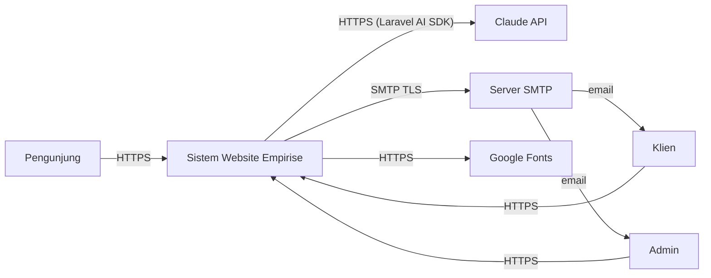

| Aktor atau sistem luar | Interaksi |
|---|---|
| Pengunjung | Menjelajahi halaman, bercerita ke Chatbot Publik, mengirim konsultasi |
| Klien | Login, menanggapi penawaran, memantau proyek, memakai Asisten Akun |
| Admin | Mengelola konsultasi, proyek, pembayaran, kalender, konten, laporan, pengguna, dan chatbot lewat `/admin` |
| Claude API | Ekstraksi preferensi, penyusunan itinerary, percakapan chatbot |
| Server SMTP | Pengiriman email transaksional |
| Google Fonts | Font Poppins (bisa di-host sendiri bila ingin tanpa dependensi luar) |

---

## 3. Arsitektur Kontainer

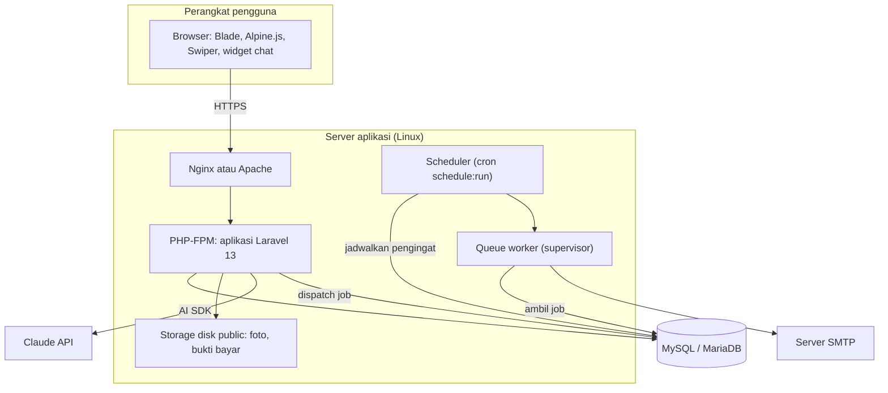

| Kontainer | Teknologi | Tanggung jawab |
|---|---|---|
| Browser | Blade (render server), Alpine.js, Swiper, FullCalendar | Tampilan, slider, widget chat, kartu draf |
| Aplikasi web | Laravel 13 di PHP-FPM | Rute, validasi, otorisasi, logika bisnis, orkestrasi AI, panel admin |
| Basis data | MySQL 8 / MariaDB | Data bisnis, log, antrean (`jobs`), sesi, cache awal |
| Queue worker | `php artisan queue:work` di bawah supervisor | Mengirim email, tugas lama di luar permintaan web |
| Scheduler | Cron menjalankan `schedule:run` tiap menit | Pengingat, pembersihan retensi, tugas berkala |
| Storage | Disk `public` (symlink) | Foto destinasi dan portofolio, bukti bayar |
| Claude API | Layanan luar | Pemrosesan bahasa untuk fitur AI |
| SMTP | Layanan luar | Pengiriman email |

Satu kode, satu basis data, tiga proses (web, worker, scheduler). Tidak ada layanan terpisah.

---

## 4. Struktur Aplikasi (Modular Monolith)

### 4.1 Lapisan

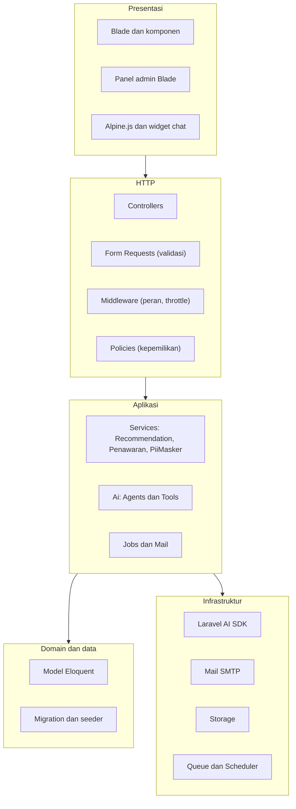

Aturan ketergantungan: lapisan atas boleh memanggil lapisan bawah, tidak sebaliknya. Controller tipis: validasi, otorisasi, panggil Service, kembalikan respons. Logika bisnis ada di Service dan model.

### 4.2 Modul

| Modul | Tanggung jawab | Lokasi utama |
|---|---|---|
| Publik | Beranda, Tentang, Layanan, Portofolio, Destinasi, Kalender, FAQ dan Kontak | `Controllers/Publik`, `views/pages`, `views/sections` |
| Akun | Registrasi, login, profil, area `/akun` | Breeze, `Controllers/Akun`, `views/akun` |
| Konsultasi | Form, percakapan, status | `Konsultasi`, `BalasanKonsultasi`, Policy |
| Rekomendasi | TF-IDF dan cosine similarity | `Services/RecommendationService` |
| AI | Agent, Tool, penyamaran PII, guardrail | `app/Ai/Agents`, `app/Ai/Tools`, `Services/PiiMasker` |
| Penawaran dan Deal | Versi penawaran, tanggapan klien, pembuatan proyek | `Services/PenawaranService` |
| Proyek dan Pembayaran | Termin, bukti, sisa tagihan | `Proyek`, `Pembayaran` |
| Notifikasi | Mailable, template, log, pengingat | `app/Mail`, `app/Jobs`, `routes/console.php` |
| Admin | Dashboard, konsultasi, proyek, kalender, konten, laporan, pengguna, dan chatbot | `app/Http/Controllers/Admin`, `resources/views/admin` |

### 4.3 Struktur Folder

```
app/
  Ai/
    Agents/              # PreferensiAgent, ItineraryAgent, ChatPublikAgent, AsistenAkunAgent
    Tools/               # alat chatbot publik dan akun
  Http/
    Controllers/{Publik,Akun,Api}
    Requests/
    Middleware/          # EnsureRole
  Models/
  Policies/
  Services/              # PiiMasker, RecommendationService, PenawaranService
  Mail/                  # 11 Mailable
  Jobs/
config/ai.php            # Laravel AI SDK
database/{migrations,seeders}
resources/{views,css,js}
routes/{web.php,console.php}
```

---

## 5. Alur Kunci

### 5.1 Itinerary AI

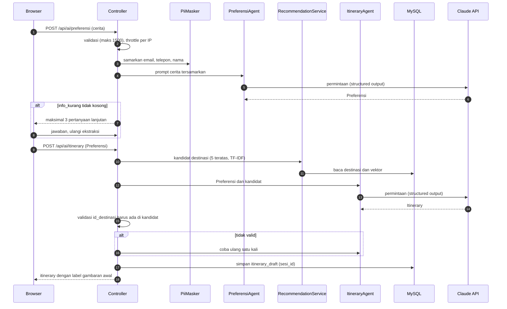

Titik kendali: PII disamarkan sebelum keluar server; peringkat destinasi dari TF-IDF bukan dari model; setiap `id_destinasi` divalidasi; jika dua kali gagal atau timeout 30 detik, klien diarahkan ke form konsultasi.

### 5.2 Kirim Itinerary menjadi Konsultasi

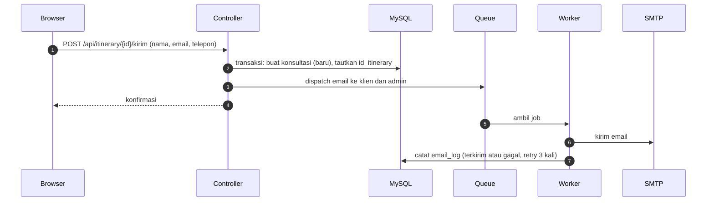

### 5.3 Deal: Klien Menyetujui Penawaran

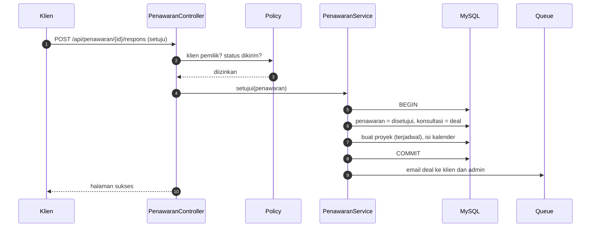

Jika langkah apa pun dalam transaksi gagal, seluruh perubahan dibatalkan. Penawaran yang sudah disetujui atau ditolak tidak dapat ditanggapi ulang.

### 5.4 Asisten Akun dan Draf

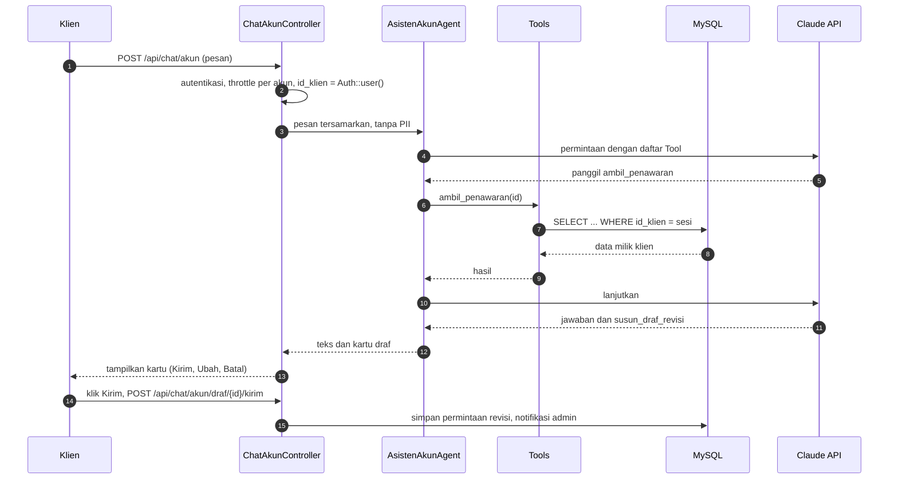

Tool tidak pernah menerima `id_klien` dari model. Tool penulis hanya membuat draf. Penulisan sebenarnya dilakukan endpoint yang dipanggil oleh klik klien.

### 5.5 Pengingat Terjadwal

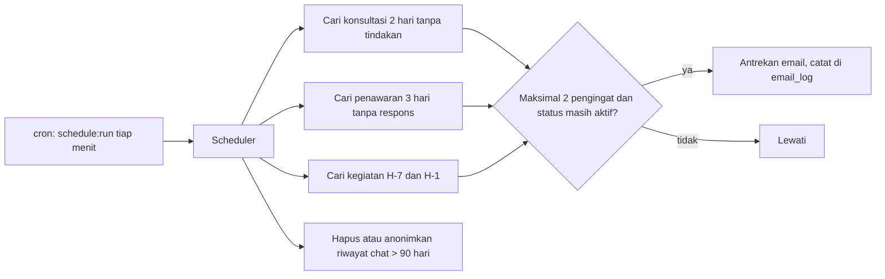

---

## 6. Arsitektur AI

### 6.1 Komponen

| Komponen | Peran |
|---|---|
| `PiiMasker` | Menyamarkan email, telepon, dan nama sebelum teks dikirim ke penyedia |
| `PreferensiAgent` | Mengubah cerita bebas menjadi Preferensi (structured output) |
| `RecommendationService` | Peringkat destinasi dengan TF-IDF dan cosine similarity, vektor di `destinasi.vektor_tfidf` |
| `ItineraryAgent` | Menyusun itinerary hanya dari kandidat (structured output) |
| `ChatPublikAgent` | Chatbot pengunjung. Tool: `cari_faq`, `rekomendasi_destinasi`, `buat_itinerary`, `cek_status_tanggal` |
| `AsistenAkunAgent` | Asisten klien login. Tool publik ditambah `ambil_konsultasi_saya`, `ambil_penawaran`, `ambil_proyek_dan_tagihan`, `susun_draf_revisi`, `susun_draf_pesan`, `simpan_itinerary` |

Semua Agent dan Tool ada di `app/Ai`, dibangun di atas Laravel AI SDK dan dibungkus kelas milik sendiri agar perubahan API SDK terisolasi. Versi `laravel/ai` dikunci di `composer.json`.

### 6.2 Pembagian Tugas Model dan Kode

| Dikerjakan model | Dikerjakan kode deterministik |
|---|---|
| Memahami cerita, merangkum kebutuhan | Peringkat destinasi (TF-IDF) |
| Menyusun urutan dan narasi itinerary | Validasi skema dan `id_destinasi` |
| Menjawab dan menyusun draf | Otorisasi dan scoping data klien |
| | Penulisan data, penetapan deal, pengiriman email |
| | Pembatasan laju dan batas panjang pesan |

### 6.3 Guardrail

| Lapisan | Kontrol |
|---|---|
| Masukan | Batas 500 karakter (biasa) dan 1500 (cerita), penyamaran PII, throttle |
| Instruksi | Prompt sistem di server: tanpa harga (kecuali kutipan nominal milik klien oleh Asisten Akun), tanpa janji tanggal, hanya data dari Tool, bahasa Indonesia |
| Keluaran | Structured output, validasi server, `id_destinasi` harus kandidat, disclaimer tetap |
| Tindakan | Tool penulis hanya membuat draf; aksi nyata lewat klik klien |
| Data | `WHERE id_klien = sesi` pada semua Tool akun, Policy kepemilikan |
| Kegagalan | Retry satu kali, timeout 10 detik (chat) dan 30 detik (itinerary), mode cadangan ke form |
| Pencatatan | `chatbot_log` dan `rekomendasi_log`, tanpa cerita sensitif mentah |

### 6.4 Perilaku Saat AI Gagal

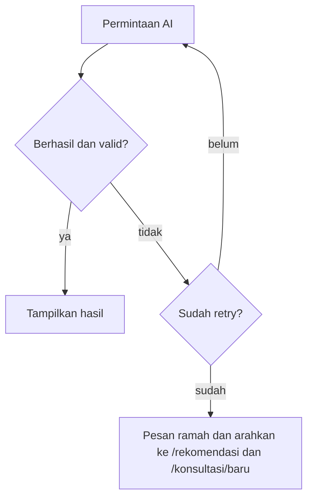

Alur konsultasi, penawaran, dan deal tidak bergantung pada AI.

### 6.5 Catatan Sinkron vs Asinkron

Itinerary dibuat sinkron dalam satu permintaan (hingga 30 detik) dengan indikator loading. Konsekuensi: satu proses PHP-FPM tertahan selama itu. Mitigasi awal: throttle 5 itinerary per jam per IP dan jumlah worker FPM yang cukup. Jika beban naik, pindahkan ke job di antrean dengan polling status (`itinerary_draft.status`).

---

## 7. Arsitektur Data

### 7.1 Entitas Utama

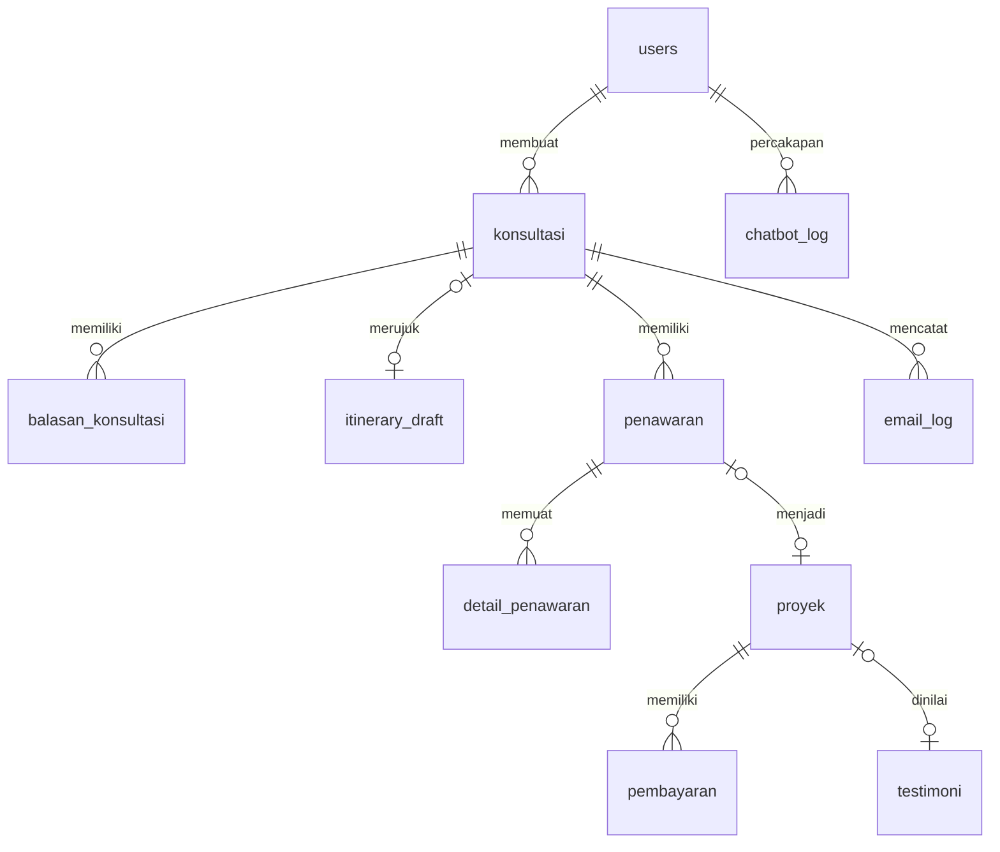

Dasar: 20 tabel di analisis Bagian 9. Tambahan: `itinerary_draft`, `email_template`, `email_log`, kolom `konsultasi.id_itinerary` dan `konsultasi.preferensi_json`, serta `chatbot_log.mode`, `.id_klien`, `.konteks_json`. Tabel sistem Laravel: `users`, `sessions`, `jobs`, `failed_jobs`, `password_reset_tokens`, `cache` (bila driver database), dan tabel milik AI SDK bila dipublikasikan.

### 7.2 Prinsip Data

| Prinsip | Penerapan |
|---|---|
| Konsistensi | InnoDB, foreign key, operasi deal dalam satu transaksi |
| Penamaan | Tabel dan primary key sesuai analisis (misalnya `id_konsultasi`) lewat atribut `#[Table(...)]` Laravel 13 atau properti `$table` dan `$primaryKey` |
| Versi penawaran | Setiap revisi membuat baris baru. Versi lama tidak diubah |
| Satu deal, satu proyek | Batas unik pada relasi penawaran ke proyek |
| Kepemilikan | Setiap data klien terhubung ke `id_klien`. Akses lewat Policy dan scope |
| Retensi | Chat akun 90 hari, `email_log` minimal 1 tahun, penawaran dan pembayaran permanen |
| Karakter | `utf8mb4`, zona waktu `Asia/Jakarta` |

### 7.3 Indeks yang Disarankan

| Tabel | Indeks | Alasan |
|---|---|---|
| `konsultasi` | `(id_klien, status)`, `(status, updated_at)` | Daftar klien, dashboard admin, pencarian pengingat |
| `penawaran` | `(id_konsultasi, versi)`, `(status, updated_at)` | Versi terbaru, pengingat 3 hari |
| `proyek` | `(tgl_mulai)`, `(status)` | Kalender, pengingat H-7 dan H-1 |
| `email_log` | `(id_konsultasi, jenis)`, `(status, jadwal_kirim)` | Batas 2 pengingat, retry |
| `itinerary_draft` | `(sesi_id)`, `(id_konsultasi)` | Penautan setelah login |
| `chatbot_log` | `(id_klien, created_at)` | Retensi dan riwayat |

---

## 8. Pemrosesan Latar dan Email

| Hal | Rancangan |
|---|---|
| Antrean | `QUEUE_CONNECTION=database` pada awal. Pindah ke Redis bila volume naik |
| Worker | `queue:work` di bawah supervisor, restart otomatis, `--tries=3` |
| Retry | 3 kali dengan jeda bertahap. Setelah gagal masuk `failed_jobs` dan `email_log.status = gagal` |
| Idempotensi | Setiap email berkunci `(id_konsultasi, jenis, referensi)` agar pengingat tidak terkirim ganda |
| Template | Tabel `email_template` (subjek, isi, aktif) dengan variabel. Admin dapat mengedit dan mematikan jenis tertentu |
| Pengirim | `Admin Empirise <admin@empirise.id>`, `Reply-To` ke email admin |
| Penghentian | Pengingat berhenti jika klien merespons atau status `batal` atau `deal`. Maksimal 2 pengingat |
| Kebijakan domain | SPF, DKIM, DMARC pada domain pengirim |

Email tidak pernah dikirim di dalam transaksi bisnis. Transaksi selesai dulu, lalu email diantrekan. Kegagalan SMTP tidak membatalkan deal.

---

## 9. Arsitektur Frontend

| Aspek | Rancangan |
|---|---|
| Render | Server-side dengan Blade. Halaman publik dapat dibaca tanpa JavaScript |
| Interaktivitas | Alpine.js untuk state ringan (slider, widget chat, kartu draf), Swiper untuk hero dan portofolio |
| Gaya | Tailwind CSS lewat Vite. Token desain (warna, radius, bayangan) di konfigurasi Tailwind |
| Komponen | `x-button`, `x-section-heading`, `x-chat-widget`, navbar, footer, section |
| Widget chat | Satu komponen yang memilih mode: `@auth` menampilkan Asisten Akun, `@guest` menampilkan Chatbot Publik. Berganti otomatis saat login dan logout |
| Komunikasi | `fetch` ke endpoint JSON dengan token CSRF, penanganan 401, 422, 429, dan 503 |
| Ikon | Lucide (`blade-lucide-icons`) |
| Responsif | Mobile-first, breakpoint 1280, 1024, 768 |
| Aksesibilitas | `alt`, `aria-label`, fokus terlihat, `prefers-reduced-motion` |
| Admin | Blade + Alpine.js + Tailwind, terpisah dari tampilan publik melalui middleware peran |

---

## 10. Keamanan

### 10.1 Lapisan Pertahanan

| Lapisan | Kontrol |
|---|---|
| Transport | HTTPS di seluruh situs, HSTS, cookie `Secure`, `HttpOnly`, `SameSite` |
| Autentikasi | Breeze, bcrypt, throttle login, reset password berbatas waktu |
| Otorisasi | Peran `klien` dan `admin` lewat middleware, Policy kepemilikan data |
| Input | Form Request di server, Eloquent atau prepared statement, batas panjang |
| Output | Escape Blade bawaan, isi chat tampil sebagai teks |
| CSRF | Token pada semua formulir dan permintaan `fetch` state-changing |
| Berkas | jpg, png, pdf maks 2 MB, nama acak, disk `public` terkontrol |
| Laju | Throttle login, chat, itinerary, form konsultasi |
| Rahasia | Kunci API dan kredensial hanya di `.env`, tidak di repositori, tidak ke browser |
| Privasi AI | PII disamarkan sebelum dikirim, ringkasan log tanpa cerita mentah, catatan privasi di form |
| Header | CSP (izinkan fonts), `X-Content-Type-Options`, `Referrer-Policy`, `X-Frame-Options` |
| Audit | Log tindakan admin penting (kirim penawaran, ubah status, hapus) |

### 10.2 Ancaman Utama dan Penangkal

| Ancaman | Dampak | Penangkal |
|---|---|---|
| Klien membuka data klien lain (IDOR) | Kebocoran data | Policy pada setiap controller dan Tool, scope `id_klien`, Feature test dua akun |
| Prompt injection lewat cerita atau pesan | AI melanggar aturan | Instruksi sistem di server, keluaran terstruktur divalidasi, Tool tanpa kemampuan menulis langsung, tindakan hanya lewat klik klien |
| AI menyebut harga atau mengarang destinasi | Klien salah paham | Aturan di instruksi, validasi `id_destinasi`, disclaimer, uji otomatis |
| PII terkirim ke penyedia AI | Pelanggaran privasi | `PiiMasker` wajib pada semua jalur, uji penyamaran |
| Penyalahgunaan biaya AI (spam) | Biaya membengkak | Throttle per IP dan per akun, batas panjang pesan, batas biaya di akun API |
| Brute force login | Pengambilalihan akun | Throttle, password kuat, notifikasi email |
| Unggahan berbahaya | Eksekusi kode | Validasi tipe dan ukuran, nama acak, tidak dieksekusi dari disk upload |
| XSS lewat teks chat atau testimoni | Pencurian sesi | Escape output, CSP |
| Email palsu atas nama biro | Penipuan klien | SPF, DKIM, DMARC |

---

## 11. Kinerja dan Skalabilitas

| Area | Strategi |
|---|---|
| Halaman publik | Render server, query dengan eager loading, cache data yang jarang berubah (layanan, klien, testimoni) |
| Gambar | Ukuran sesuai, `loading=lazy`, format terkompresi |
| Rekomendasi | Vektor TF-IDF disimpan di database dan di-cache. Hitung ulang saat destinasi berubah. Target kurang dari 2 detik untuk hingga 500 destinasi |
| AI | Throttle, timeout, retry terbatas. Opsi pindah ke job asinkron dengan polling |
| Email | Selalu lewat antrean |
| Basis data | Indeks Bagian 7.3, transaksi pendek |
| Cache | Awal: driver file atau database. Tahap lanjut: Redis |

Jalur skala bila trafik naik: (1) Redis untuk cache, sesi, dan antrean, (2) lebih banyak worker queue, (3) basis data terpisah dari server aplikasi, (4) CDN untuk aset statis dan gambar, (5) replika baca untuk laporan.

---

## 12. Penerapan (Deployment)

### 12.1 Topologi

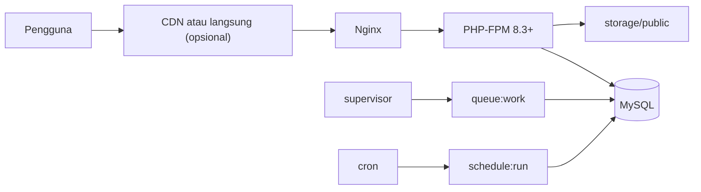

### 12.2 Lingkungan

| Lingkungan | Tujuan | Catatan |
|---|---|---|
| Lokal | Pengembangan | SQLite atau MySQL lokal, `Mail::log`, AI dengan fake |
| Staging | UAT dan uji beban | Konfigurasi menyerupai produksi, data uji, SMTP sandbox |
| Produksi | Pengguna sebenarnya | HTTPS, backup harian, pemantauan |

### 12.3 Konfigurasi (`.env`)

| Kelompok | Variabel |
|---|---|
| Aplikasi | `APP_ENV`, `APP_URL`, `APP_KEY`, `APP_TIMEZONE=Asia/Jakarta`, `APP_LOCALE=id` |
| Basis data | `DB_CONNECTION=mysql`, `DB_HOST`, `DB_PORT`, `DB_DATABASE`, `DB_USERNAME`, `DB_PASSWORD` |
| Email | `MAIL_MAILER`, `MAIL_HOST`, `MAIL_PORT`, `MAIL_USERNAME`, `MAIL_PASSWORD`, `MAIL_FROM_ADDRESS`, `MAIL_FROM_NAME` |
| Antrean dan sesi | `QUEUE_CONNECTION=database`, `SESSION_DRIVER`, `CACHE_STORE` |
| AI | Kunci dan model penyedia (nama variabel mengikuti dokumentasi Laravel AI SDK), batas laju |

### 12.4 Alur Rilis

1. Commit ke cabang fitur, buka pull request.
2. CI: `composer install`, `npm ci && npm run build`, `pint` (gaya kode), `pest` (termasuk tes isolasi data dan AI dengan fake).
3. Merge ke `main` memicu penerapan ke staging.
4. UAT di staging, lalu rilis ke produksi.
5. Langkah rilis: `php artisan migrate --force`, `config:cache`, `route:cache`, `view:cache`, `queue:restart`.
6. Rollback: kembali ke rilis sebelumnya dan jalankan migrasi turun bila diperlukan.

### 12.5 Backup dan Pemulihan

| Hal | Kebijakan |
|---|---|
| Basis data | Dump harian terenkripsi, simpan minimal 14 hari, uji pemulihan berkala |
| Berkas unggahan | Salinan harian disk `public` |
| Rahasia | Disimpan terpisah dari repositori |

---

## 13. Observabilitas

| Aspek | Rancangan |
|---|---|
| Log aplikasi | Log harian Laravel dengan level, tanpa PII dan tanpa kunci |
| Kesalahan | Pelacak kesalahan (Sentry atau setara) untuk web dan worker |
| Antrean | Pantau `jobs` dan `failed_jobs`, peringatan bila menumpuk |
| AI | Catat latensi, jumlah retry, tingkat kegagalan, dan perkiraan biaya per hari. Peringatan bila melewati ambang |
| Email | `email_log` untuk status, dashboard admin menampilkan yang gagal |
| Kesehatan | Endpoint cek kesehatan sederhana untuk pemantau uptime |
| Audit | Log tindakan admin penting |

---

## 14. Pengujian pada Tingkat Arsitektur

| Tujuan | Pengujian |
|---|---|
| Isolasi data | Feature test dua akun klien pada web, API, dan chatbot |
| Transaksi deal | Tes bahwa kegagalan di tengah membatalkan semua perubahan |
| Batas AI | Tes dengan fake: tanpa harga, hanya kandidat, mode cadangan, draf tidak terkirim tanpa klik |
| Email | `Mail::fake` dan `Queue::fake`, tes batas 2 pengingat dan penghentian |
| Kinerja | Lighthouse mobile dan uji beban 100 pengguna bersamaan pada halaman publik |
| Keamanan | Pemeriksaan header, tes throttle, tes unggahan |

---

## 15. Keputusan Arsitektur (ADR Ringkas)

| ID | Keputusan | Alasan | Konsekuensi |
|---|---|---|---|
| ADR-01 | Monolit modular Laravel | Skala kecil, tim kecil, operasi sederhana | Semua dalam satu kode. Batas modul dijaga lewat konvensi |
| ADR-02 | MySQL 8 / MariaDB | Sesuai analisis dan umum di hosting | Tidak ada fitur khusus basis data lain |
| ADR-03 | Blade + Alpine + Tailwind, bukan SPA | Cepat, SEO baik, ringan di ponsel, cocok desain landing page | Interaksi kompleks terbatas. Cukup untuk lingkup ini |
| ADR-04 | Panel admin Blade kustom, bukan Filament | Konsisten dengan desain yang disetujui dan menghindari dependensi admin yang belum terpasang | CRUD dan pola UI perlu dipelihara oleh aplikasi |
| ADR-05 | Breeze untuk autentikasi | Sederhana, cocok Blade | Tidak lagi menerima fitur baru. Alternatif: starter kit Livewire atau Fortify |
| ADR-06 | Laravel AI SDK dibungkus kelas sendiri | Resmi dan terintegrasi, tetapi API dapat berubah | Versi dikunci. Perubahan SDK terisolasi di `app/Ai` |
| ADR-07 | TF-IDF di PHP untuk peringkat destinasi | Sesuai analisis, murah, dapat dijelaskan | Kualitas bergantung data tag dan deskripsi. Embedding jadi opsi fase lanjut |
| ADR-08 | LLM hanya untuk bahasa, kode untuk keputusan | Mengurangi halusinasi dan risiko | Perlu skema dan validasi ketat |
| ADR-09 | AI hanya menyusun draf, aksi lewat klik klien | Mencegah tindakan tak sah dan prompt injection berdampak | Satu langkah klik tambahan bagi klien |
| ADR-10 | Antrean database dahulu | Tanpa infrastruktur tambahan | Pindah ke Redis bila volume naik |
| ADR-11 | Pembayaran dicatat manual | Di luar lingkup payment gateway | Admin menginput bukti bayar |
| ADR-12 | Itinerary sinkron dengan timeout 30 detik | Pengalaman langsung bagi pengguna | Menahan proses FPM. Mitigasi throttle. Opsi asinkron disiapkan |
| ADR-13 | Penyamaran PII sebelum ke penyedia AI | Sesuai KNF-11 dan privasi | Kualitas konteks sedikit berkurang untuk nama |
| ADR-14 | Satu widget, dua mode berdasarkan status login | Pengalaman konsisten | Mode dipilih di server, bukan dari input pengguna |

---

## 16. Risiko Arsitektural

| Risiko | Mitigasi |
|---|---|
| API Laravel AI SDK berubah antarversi | Kunci versi, bungkus di Agent dan Tool sendiri, baca dokumentasi resmi, uji dengan fake |
| Ketergantungan pada satu penyedia AI | Konfigurasi provider dan model di `config/ai.php`, mode cadangan ke form |
| Biaya AI tak terkendali | Throttle, batas panjang, batas biaya di akun API, pemantauan harian |
| Data destinasi sedikit atau buruk | Minimal 20 sampai 30 destinasi dengan tag dan deskripsi sebelum fitur AI dirilis |
| Worker atau cron mati | Supervisor, pemantauan antrean, peringatan |
| Email masuk spam | SPF, DKIM, DMARC, template ringkas |
| Modul panel admin berkembang | Pertahankan controller tipis, validasi server, dan logika bisnis di Service |
| PHP-FPM kehabisan worker saat itinerary ramai | Throttle, tambah worker, opsi asinkron |

---

## 17. Evolusi ke Depan

| Tahap | Peningkatan |
|---|---|
| Berikutnya | Unduh itinerary PDF, notifikasi WhatsApp, payment gateway |
| Rekomendasi | Embedding dan pencarian vektor (didukung Laravel 13 dan AI SDK), hybrid dengan TF-IDF |
| Skala | Redis untuk cache, sesi, antrean. CDN. Replika baca |
| AI | Itinerary asinkron, evaluasi kualitas otomatis, ringkasan konsultasi untuk admin |
| Produk | Multi-bahasa, portal klien lebih kaya |

---

## 18. Rujukan

1. `PRD_Empirise_Jalan-Jalan.md`
2. `SRS_Empirise_Jalan-Jalan.md`
3. `analsis_pweb_empiris.docx` (KF, KNF, ERD, aturan bisnis)
4. Panduan Membangun Website Empirise Jalan-Jalan (Laravel + MySQL)
5. Dokumentasi resmi Laravel 13 dan Laravel AI SDK
